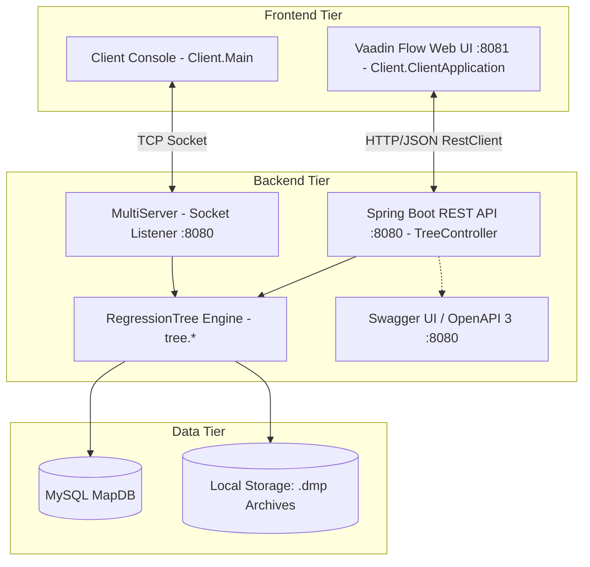

# Albero di Regressione (Java)

[](https://openjdk.org/)
[](https://maven.apache.org/)
[](https://spring.io/projects/spring-boot)
[](https://vaadin.com/)
[](http://localhost:8080/swagger-ui.html)
[](https://www.mysql.com/)
[](docs/documentazione-test.md)
[-brightgreen.svg)](docs/javadoc/index.html)

Sistema distribuito in Java per l'apprendimento induttivo, la serializzazione binaria e la predizione supervisionata mediante **Alberi di Regressione** (Regression Trees). Il sistema integra un'architettura duale:
1. **Modalità Socket TCP Concorrente (Console):** demone multithread su porta `8080` con client terminale interattivo.
2. **Modalità Web Enterprise (REST & Vaadin):** backend Spring Boot 3.4.3 con REST API stateless, documentazione interattiva OpenAPI/Swagger UI su porta `8080` (`http://localhost:8080/swagger-ui.html`) e interfaccia web reattiva in puro Java con Vaadin Flow su porta `8081` (`http://localhost:8081`).

Il core matematico include persistenza relazionale su database MySQL (`MapDB`), calcolo ottimizzato della varianza ($SSE$), partizionamento in-place con quicksort e supporto ad attributi discreti e continui.

---

## 📑 Indice dei Contenuti

- [Panoramica del Progetto](#panoramica-del-progetto)
- [Architettura del Sistema](#architettura-del-sistema)
- [Indice della Documentazione](#indice-della-documentazione)
- [Guida Rapida all'Avvio](#guida-rapida-allavvio)
  - [1. Configurazione Rapida Database MySQL](#1-configurazione-rapida-database-mysql)
  - [2. Compilazione del Progetto](#2-compilazione-del-progetto)
  - [3. Modalità Web: Avvio Server REST e Client Vaadin](#3-modalità-web-avvio-server-rest-e-client-vaadin)
  - [4. Modalità Socket TCP (Console Tradizionale)](#4-modalità-socket-tcp-console-tradizionale)
  - [5. Esecuzione dei Test Automatizzati](#5-esecuzione-dei-test-automatizzati)
- [Risoluzione Automatica delle Dipendenze con Maven](#risoluzione-automatica-delle-dipendenze-con-maven)
- [Generazione della Documentazione (PDF e Javadoc)](#generazione-della-documentazione-pdf-e-javadoc)
- [Struttura della Repository](#struttura-della-repository)
- [Autore e Licenza](#autore-e-licenza)

---

## Panoramica del Progetto

Il software affronta problemi di regressione numerica supervisionata:
- **Induzione Ricorsiva dell'Albero:** Minimizzazione progressiva della Somma dei Quadrati degli Errori ($SSE$) sui nodi interni.
- **Split Polimorfici:**
  - *Attributi Discreti (`DiscreteNode`):* partizionamento multi-ramo con scansione lineare post-ordinamento contiguo.
  - *Attributi Continui (`ContinuousNode`):* ricerca della soglia di taglio binario ottima $\tau$ minimizzando la somma degli $SSE$ dei due rami candidati ($\le \tau$ e $> \tau$).
- **Navigazione Stateless:** Metodo `navigate(List<Integer> path)` che consente l'ispezione dell'albero e la predizione passo-passo via HTTP/REST senza dipendenza da connessioni socket aperte.
- **Interfaccia Web Vaadin Flow:** Dashboard in puro Java su porta `8081` con navigazione visuale dei bivi decisionali e visualizzazione istantanea delle regole IF-THEN.
- **Specifiche OpenAPI 3 e Swagger UI:** Endpoint documentati interattivamente su `/swagger-ui.html`.
- **Ottimizzazione di Memoria:** Ordinamento in-place mediante **quicksort** con profondità stack $O(\log_2 n)$.
- **Server Socket Concorrente (`MultiServer`):** Gestione multithread su socket TCP.
- **Persistenza Binaria (`.dmp`):** Serializzazione del modello su disco per interrogazioni immediate a freddo.

---

## Architettura del Sistema



---

## Indice della Documentazione

L'intera documentazione tecnica e operativa del progetto è disponibile sia in formato sorgente **Markdown (`.md`)** sia in formato ad alta definizione **PDF (`docs/pdf/*.pdf`)**, affiancata dalla documentazione API aggregata **Javadoc**:

| Documento | Descrizione | Versione Markdown | Versione PDF |
|---|---|:---:|:---:|
| **Guida Tecnica Completa** | Architettura three-tier, formulazione matematica $SSE$, quicksort in-place, split discreti/continui, protocollo socket, REST API e Vaadin. | [docs/guida-tecnica.md](docs/guida-tecnica.md) | [docs/pdf/guida-tecnica.pdf](docs/pdf/guida-tecnica.pdf) |
| **Guida Utente e Installazione** | Script SQL `MapDB`, credenziali `MapUser`/`map`, uso interfaccia Web Vaadin Flow, Swagger UI ed esecuzione CLI. | [docs/guida-utente-installazione.md](docs/guida-utente-installazione.md) | [docs/pdf/guida-utente-installazione.pdf](docs/pdf/guida-utente-installazione.pdf) |
| **Documentazione della Suite di Test** | Matrice di tracciabilità requisiti, 60 test automatizzati (JUnit 5, Mockito, Spring Boot Test E2E, RestClient) a 0 errori. | [docs/documentazione-test.md](docs/documentazione-test.md) | [docs/pdf/documentazione-test.pdf](docs/pdf/documentazione-test.pdf) |
| **Diagrammi UML e Architettura dei Package** | Raccolta completa e visuale di tutti i diagrammi UML del sistema (Package, Classi per ogni package, Sequenza e Deployment). | [docs/architettura-uml-oop.md](docs/architettura-uml-oop.md) | [docs/pdf/architettura-uml-oop.pdf](docs/pdf/architettura-uml-oop.pdf) |
| **Documentazione Javadoc** | Documentazione API completa di tutti i package (inclusi metodi e campi privati). | [docs/javadoc/index.html](docs/javadoc/index.html) | — |
| **README di Progetto** | Panoramica sintetica, architettura, badge, comandi di build e avvio. | [README.md](README.md) | [docs/pdf/README.pdf](docs/pdf/README.pdf) |

---

## Guida Rapida all'Avvio

### 1. Configurazione Rapida Database MySQL

Assicurarsi che il servizio MySQL sia attivo su `localhost:3306`, quindi eseguire lo script di bootstrap:

```sql
CREATE DATABASE IF NOT EXISTS MapDB;
CREATE USER IF NOT EXISTS 'MapUser'@'localhost' IDENTIFIED BY 'map';
GRANT ALL PRIVILEGES ON MapDB.* TO 'MapUser'@'localhost';
FLUSH PRIVILEGES;

USE MapDB;

DROP TABLE IF EXISTS provaC;
CREATE TABLE provaC (
    X VARCHAR(10) NOT NULL,
    Y DOUBLE NOT NULL,
    C DOUBLE NOT NULL
);

INSERT INTO provaC (X, Y, C) VALUES
('A', 2.0, 1.0), ('A', 2.0, 1.0), ('A', 1.0, 1.0), ('A', 2.0, 1.0),
('A', 5.0, 1.5), ('A', 5.0, 1.5), ('A', 6.0, 1.5), ('B', 6.0, 10.0),
('A', 6.0, 1.5), ('A', 6.0, 1.5), ('B', 10.0, 10.0), ('B', 5.0, 10.0),
('B', 12.0, 10.0), ('B', 14.0, 10.0), ('A', 1.0, 1.0);
```

### 2. Compilazione del Progetto

Dalla radice della repository:

```bash
mvn clean compile
```

### 3. Modalità Web: Avvio Server REST e Client Vaadin

#### 3.1 Avvio Backend Spring Boot REST API (Porta 8080):
```bash
cd Server
mvn spring-boot:run
# Oppure dalla root: mvn -pl Server spring-boot:run
```
- **Swagger UI:** `http://localhost:8080/swagger-ui.html`
- **OpenAPI 3 Spec (JSON):** `http://localhost:8080/v3/api-docs`

#### 3.2 Avvio Frontend Web Vaadin Flow (Porta 8081):
In un secondo terminale separato:
```bash
cd Client
mvn spring-boot:run
# Oppure dalla root: mvn -pl Client spring-boot:run
```
- **Interfaccia Web:** `http://localhost:8081`

### 4. Modalità Socket TCP (Console Tradizionale)

#### Avvio del Server Socket:
```bash
cd Server
mvn compile exec:java -Dexec.mainClass="Main"
# Oppure dalla root: mvn -pl Server compile exec:java -Dexec.mainClass="Main"
```

#### Avvio del Client Console:
In un secondo terminale:
```bash
cd Client
mvn compile exec:java -Dexec.mainClass="Client.Main"
# Oppure dalla root: mvn -pl Client compile exec:java -Dexec.mainClass="Client.Main"
```

### 5. Esecuzione dei Test Automatizzati

Esecuzione dell'intera suite (55 test unitari, d'integrazione, socket ed end-to-end):

```bash
mvn clean test
```

---

## Generazione della Documentazione (PDF e Javadoc)

La documentazione API tecnica Javadoc aggregata di entrambi i moduli (inclusiva di tutti i dettagli privati e dei nodi package-private) può essere generata tramite Maven:

```bash
mvn javadoc:aggregate
```

L'albero HTML risultante è situato in `docs/javadoc/` e può essere consultato aprendo `docs/javadoc/index.html` con qualsiasi browser.
Le versioni ad alta definizione pronte per la stampa e la consultazione offline sono archiviate in formato vettoriale in `docs/pdf/`.

---

## Struttura della Repository

```text
.
├── Client/                             # Modulo Client (Console CLI + Web Vaadin Flow)
│   ├── pom.xml                         # Dipendenze (Vaadin 24.6.4, Spring Boot Web)
│   ├── src/main/java/
│   │   ├── Client/                     # ClientApplication.java, Main.java, MainView.java, TreeRestClientService.java
│   │   ├── dto/                        # Record DTO immutabili per REST
│   │   └── utility/                    # Keyboard.java (input da console)
│   └── src/test/java/                  # Suite di test modulo Client (16 test)
├── Server/                             # Modulo Server (Socket TCP + Backend REST API)
│   ├── pom.xml                         # Dipendenze (Spring Boot, MySQL Connector 8.4.0, OpenAPI)
│   ├── src/main/java/
│   │   ├── Main.java                   # Entrypoint Server Socket (MultiServer su porta 8080)
│   │   ├── data/                       # Data, Attribute, DiscreteAttribute, ContinuousAttribute
│   │   ├── database/                   # DbAccess, TableSchema, TableData, Example, Column
│   │   ├── dto/                        # Record DTO immutabili (TreeRequestDto, PredictionStepDto, ...)
│   │   ├── server/                     # ServerApplication, TreeController, TreeService, GlobalExceptionHandler, MultiServer
│   │   └── tree/                       # RegressionTree, Node, SplitNode, LeafNode, DiscreteNode, ContinuousNode
│   └── src/test/java/                  # Suite di test modulo Server (44 test)
├── docs/                               # Documentazione completa di progetto
│   ├── guida-tecnica.md                # Guida Tecnica Completa
│   ├── guida-utente-installazione.md   # Guida Utente ed Esempi
│   ├── architettura-uml-oop.md         # 11 Diagrammi UML ufficiali
│   ├── documentazione-test.md          # Matrice di tracciabilità e schede test
│   ├── javadoc/                        # Javadoc HTML aggregato (visibilità private completa)
│   └── pdf/                            # Versioni PDF ad alta definizione dei documenti
│       ├── guida-tecnica.pdf
│       ├── guida-utente-installazione.pdf
│       ├── architettura-uml-oop.pdf
│       ├── documentazione-test.pdf
│       └── README.pdf
├── pom.xml                             # Root POM aggregator (Java 21 LTS, javadoc aggregate 3.11.2)
└── README.md                           # Panoramica e indice principale
```

---

## Autore e Licenza

- **Autore:** Marco Diana  
- **Progetto:** Albero di Regressione (Corso di Metodi Avanzati di Programmazione)  
- **Licenza:** Progetto ad uso didattico e accademico.
