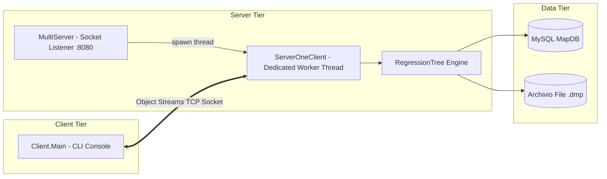

# Albero di Regressione (Java)

[](https://openjdk.org/)
[](https://maven.apache.org/)
[](https://www.mysql.com/)
[](#architettura-del-sistema)
[-brightgreen.svg)](docs/javadoc/index.html)

Sistema distribuito in Java per l'apprendimento induttivo, la serializzazione binaria e la predizione supervisionata mediante **Alberi di Regressione** (Regression Trees). Il sistema integra un'architettura **Three-Tier** basata su socket TCP concorrenti, persistenza relazionale su database MySQL (`MapDB`), calcolo matematico della varianza ($SSE$), partizionamento in-place con quicksort ottimizzato e supporto completo ad attributi continui e discreti.

---

## 📑 Indice dei Contenuti

- [Panoramica del Progetto](#panoramica-del-progetto)
- [Architettura del Sistema](#architettura-del-sistema)
- [Indice della Documentazione](#indice-della-documentazione)
- [Guida Rapida all'Avvio](#guida-rapida-allavvio)
  - [1. Configurazione Rapida Database MySQL](#1-configurazione-rapida-database-mysql)
  - [2. Compilazione del Progetto](#2-compilazione-del-progetto)
  - [3. Esecuzione Server e Client](#3-esecuzione-server-e-client)
- [Risoluzione Automatica delle Dipendenze con Maven](#risoluzione-automatica-delle-dipendenze-con-maven)
- [Generazione della Documentazione (PDF e Javadoc)](#generazione-della-documentazione-pdf-e-javadoc)
- [Struttura della Repository](#struttura-della-repository)
- [Autore e Licenza](#autore-e-licenza)

---

## Panoramica del Progetto

Il software affronta problemi di regressione numerica supervisionata:
- **Induzione Ricorsiva dell'Albero:** Minimizzazione progressiva della Somma dei Quadrati degli Errori ($SSE$) sui nodi interni.
- **Split Polimorfici:**
  - *Attributi Discreti (`DiscreteNode`):* partizionamento multi-ramo con scansione lineare post-ordinamento contiguo.
  - *Attributi Continui (`ContinuousNode`):* ricerca della soglia di taglio binario ottima $\tau$ minimizzando la somma degli $SSE$ dei due rami candidati ($\le \tau$ e $> \tau$).
- **Ottimizzazione di Memoria:** Ordinamento in-place mediante **quicksort** con ricorsione prioritaria sulla partizione di cardinalità minore, limitando la profondità dello stack a $O(\log_2 n)$.
- **Server Socket Concorrente (`MultiServer`):** Gestione multithread delle richieste client su socket TCP (porta `8080`).
- **Persistenza Binaria (`.dmp`):** Serializzazione nativa del modello indotto su file per consentire interrogazioni e predizioni istantanee a freddo senza ri-addestramento da database.

---

## Architettura del Sistema



---

## Indice della Documentazione

L'intera documentazione tecnica e operativa del progetto è disponibile sia in formato sorgente **Markdown (`.md`)** sia in formato ad alta definizione **PDF (`docs/pdf/*.pdf`)**, affiancata dalla documentazione API aggregata **Javadoc**:

| Documento | Descrizione | Versione Markdown | Versione PDF |
|---|---|:---:|:---:|
| **Guida Tecnica Completa** | Architettura three-tier, formulazione matematica $SSE$, quicksort in-place, split discreti/continui, protocollo socket e gestione eccezioni. | [docs/guida-tecnica.md](docs/guida-tecnica.md) | [docs/pdf/guida-tecnica.pdf](docs/pdf/guida-tecnica.pdf) |
| **Guida Utente e Installazione** | Requisiti, script SQL `MapDB`, credenziali `MapUser`/`map`, tabelle `provaC`/`servo`, esecuzione passo-passo CLI e IntelliJ, casi d'uso ed FAQ. | [docs/guida-utente-installazione.md](docs/guida-utente-installazione.md) | [docs/pdf/guida-utente-installazione.pdf](docs/pdf/guida-utente-installazione.pdf) |
| **Documentazione Javadoc** | Documentazione API completa di tutti i package (`data`, `database`, `tree`, `server`, `Client`, `utility`), inclusi metodi e campi privati. | [docs/javadoc/index.html](docs/javadoc/index.html) | — |
| **README di Progetto** | Panoramica sintetica, architettura, badge, comandi di build e navigazione rapida. | [README.md](README.md) | [docs/pdf/README.pdf](docs/pdf/README.pdf) |

---

## Guida Rapida all'Avvio

### 1. Configurazione Rapida Database MySQL

Assicurarsi che il servizio MySQL sia attivo su `localhost:3306`, quindi eseguire lo script di bootstrap (da terminale MySQL o MySQL Workbench):

```sql
CREATE DATABASE IF NOT EXISTS MapDB;
CREATE USER IF NOT EXISTS 'MapUser'@'localhost' IDENTIFIED BY 'map';
GRANT ALL PRIVILEGES ON MapDB.* TO 'MapUser'@'localhost';
FLUSH PRIVILEGES;

USE MapDB;

DROP TABLE IF EXISTS provaC;
CREATE TABLE provaC (
    X VARCHAR(10) NOT NULL,
    Y DOUBLE NOT NULL,
    C DOUBLE NOT NULL
);

INSERT INTO provaC (X, Y, C) VALUES
('A', 2.0, 1.0), ('A', 2.0, 1.0), ('A', 1.0, 1.0), ('A', 2.0, 1.0),
('A', 5.0, 1.5), ('A', 5.0, 1.5), ('A', 6.0, 1.5), ('B', 6.0, 10.0),
('A', 6.0, 1.5), ('A', 6.0, 1.5), ('B', 10.0, 10.0), ('B', 5.0, 10.0),
('B', 12.0, 10.0), ('B', 14.0, 10.0), ('A', 1.0, 1.0);
```

### 2. Compilazione del Progetto

Dalla radice della repository:

```bash
mvn clean compile
```

### 3. Esecuzione Server e Client

#### Avvio del Server:
```bash
# Avvio con classpath comprensivo del driver MySQL scaricato da Maven
java -cp "Server/target/classes;C:/Users/marco/.m2/repository/com/mysql/mysql-connector-j/8.4.0/mysql-connector-j-8.4.0.jar" Main
```
*Output atteso:* `Server is listening on port 8080`.

#### Avvio del Client:
In un secondo terminale:
```bash
java -cp "Client/target/classes" Client.Main
```
Seguire il menu su schermo:
- Digitare `1` per apprendere da database e inserire `provaC`.
- Navigare i bivi numerici `QUERY` per effettuare la predizione della classe target.

---

## Risoluzione Automatica delle Dipendenze con Maven

Il progetto non richiede il download o la configurazione manuale di file `.jar`:
- **Nessuna installazione esterna:** Tutte le librerie (driver MySQL JDBC `mysql-connector-j`, plugin di compilazione e plugin `maven-javadoc-plugin`) vengono scaricate automaticamente da **Maven Central** nella cache locale (`~/.m2/repository`).
- **Compatibilità con Estensioni Future:** Anche l'introduzione dei moduli per le REST API (**Spring Boot Starter Web**, **SpringDoc OpenAPI Swagger**) e per l'interfaccia web interattiva (**Vaadin Flow**) è gestita in maniera completamente automatizzata tramite Maven, includendo la gestione trasparente del frontend senza bisogno di installare Node.js o runtime esterni sul computer dell'utente.

---

## Generazione della Documentazione (PDF e Javadoc)

È possibile rigenerare l'intera documentazione tecnica e i file PDF ad alta risoluzione eseguendo lo script PowerShell dedicato:

```powershell
powershell -ExecutionPolicy Bypass -File scripts/build-docs.ps1
```

Lo script esegue:
1. `mvn javadoc:aggregate` per compilare il Javadoc aggregato con visibilità `private` in `docs/javadoc/`.
2. Rendering vettoriale dei PDF ad alta risoluzione in `docs/pdf/` per `guida-tecnica.pdf`, `guida-utente-installazione.pdf` e `README.pdf`.

---

## Struttura della Repository

```text
.
├── Client/                     # Modulo Client a riga di comando
│   ├── pom.xml                 # Configurazione Maven del client
│   └── src/main/java/
│       ├── Client/             # Main.java (punto di ingresso CLI)
│       └── utility/            # Keyboard.java (gestione robusta input da console)
├── Server/                     # Modulo Server e Motore di Regressione
│   ├── pom.xml                 # Dipendenze (mysql-connector-j 8.4.0)
│   └── src/main/java/
│       ├── Main.java           # Entrypoint Server (avvio MultiServer su porta 8080)
│       ├── data/               # Strutture dati: Data, Attribute, DiscreteAttribute, ContinuousAttribute
│       ├── database/           # Accesso JDBC: DbAccess, TableSchema, TableData, Example, Column
│       ├── server/             # Networking: MultiServer, ServerOneClient, eccezioni
│       └── tree/               # Motore ad albero: RegressionTree, Node, SplitNode, LeafNode, ...
├── docs/                       # Documentazione completa di progetto
│   ├── guida-tecnica.md        # Guida Tecnica Completa
│   ├── guida-utente-installazione.md # Guida Utente ed Esempi
│   ├── javadoc/                # Javadoc HTML aggregato (apidocs)
│   └── pdf/                    # Versioni PDF ad alta risoluzione
│       ├── guida-tecnica.pdf
│       ├── guida-utente-installazione.pdf
│       └── README.pdf
├── scripts/
│   └── build-docs.ps1          # Script PowerShell per rigenerare PDF e Javadoc
├── pom.xml                     # Root POM aggregator (Java 25, javadoc plugin 3.11.2)
└── README.md                   # Panoramica e indice principale
```

---

## Autore e Licenza

- **Autore:** Marco Diana  
- **Progetto:** Albero di Regressione (Corso di Metodi Avanzati di Programmazione)  
- **Licenza:** Progetto ad uso didattico e accademico.
