# Diagrammi UML e Architettura dei Package

## 1. Architettura dei Package e Dipendenze («import»)

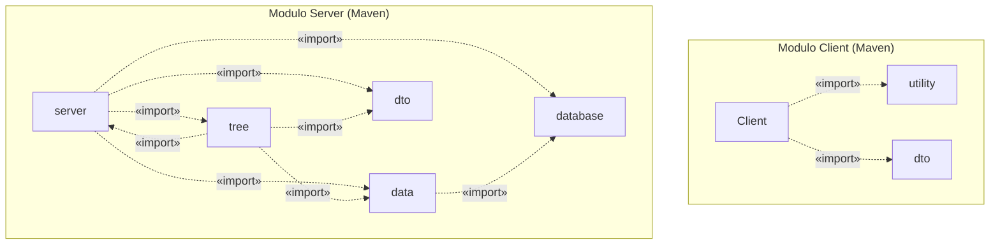

## 2. Diagramma UML delle Classi — Package `data`

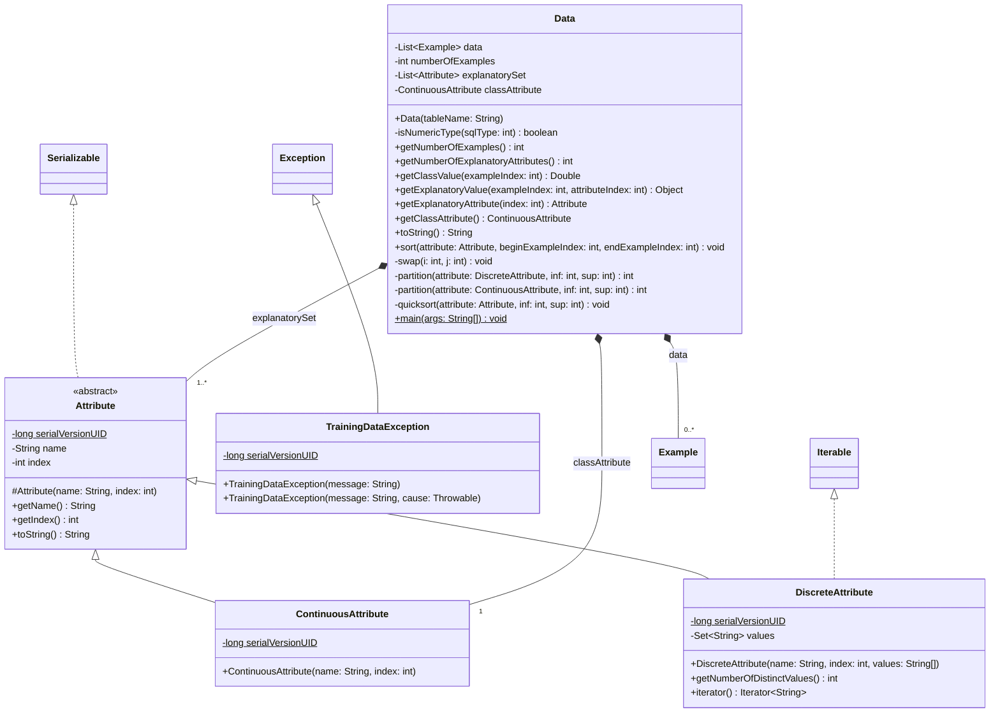

## 3. Diagramma UML delle Classi — Package `database`

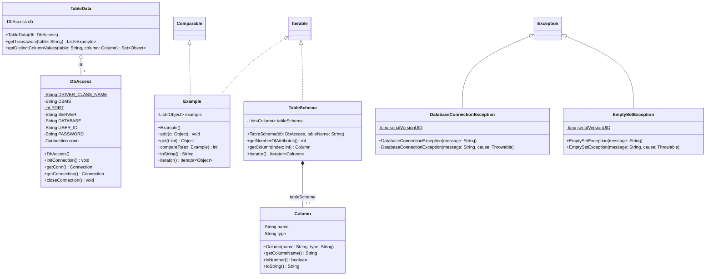

## 4. Diagramma UML delle Classi — Package `tree`

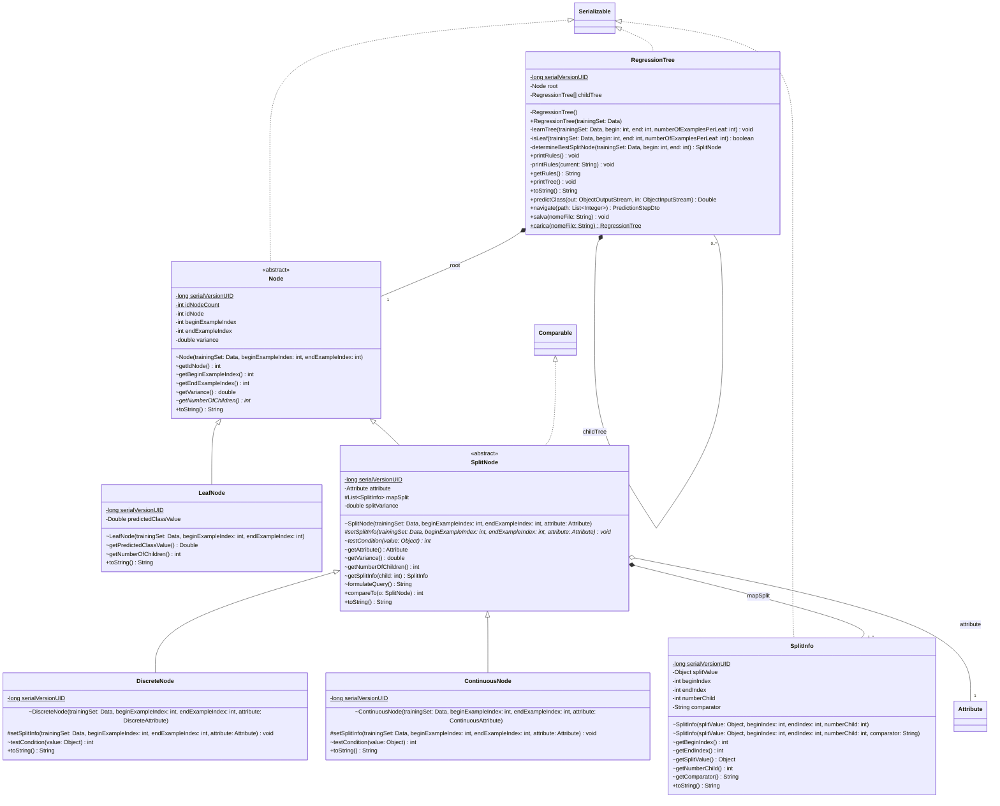

## 5. Diagramma UML delle Classi — Package `server`

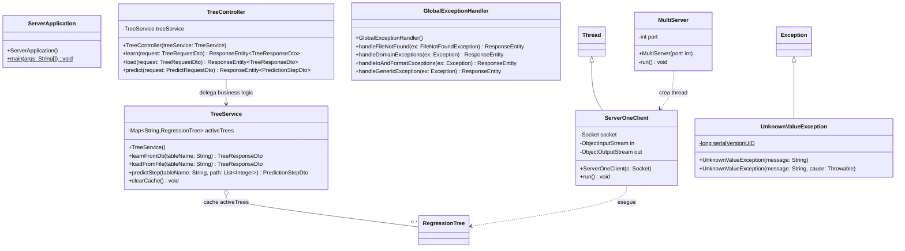

## 6. Diagramma UML delle Classi — Package `Client` e `utility`

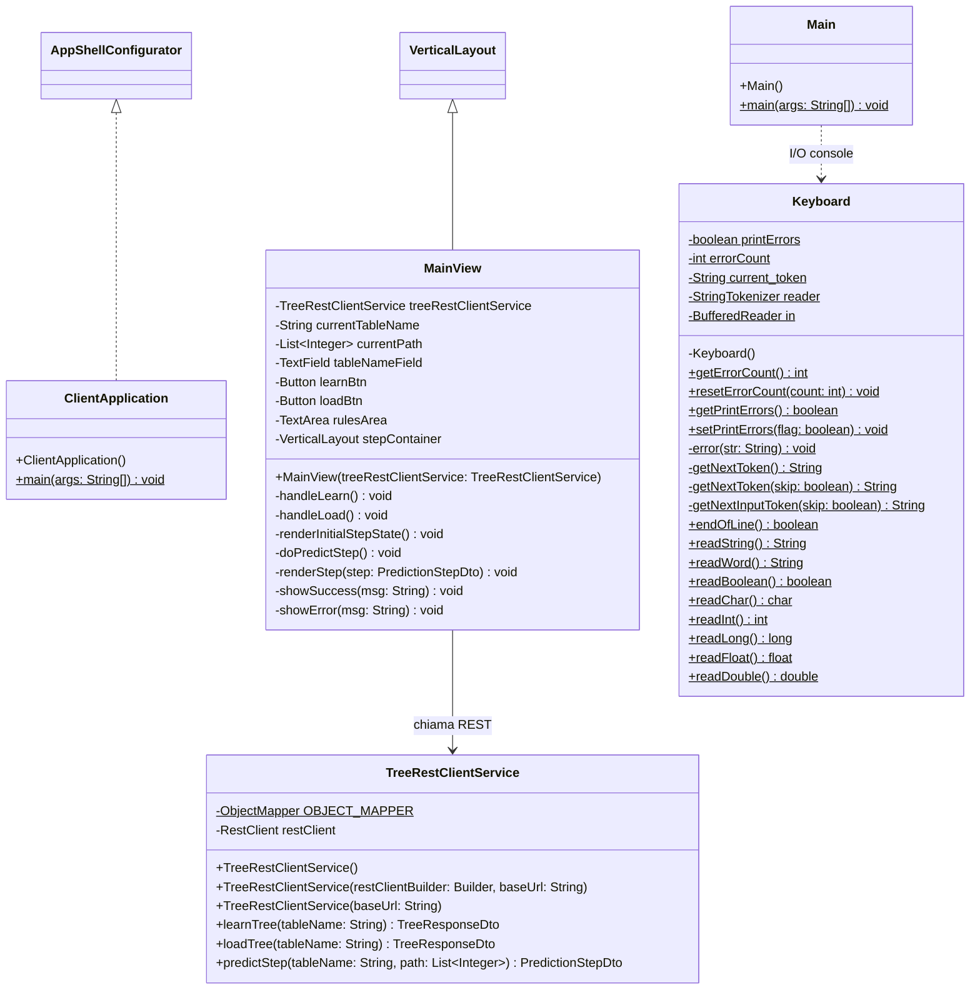

## 7. Diagramma UML delle Classi — Package `dto` (Contratti JSON)

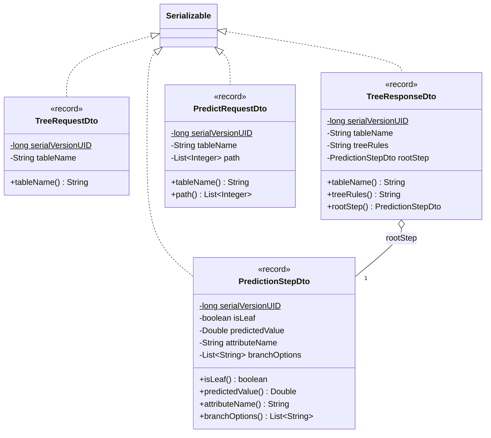

## 8. Diagramma di Sequenza 1: Apprendimento e Navigazione REST Stateless (Spring Boot 8080)

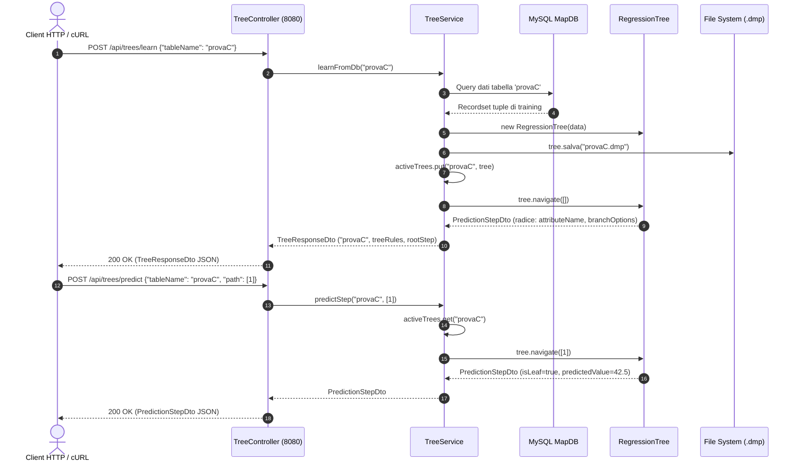

## 9. Diagramma di Sequenza 2: Interazione Web UI Vaadin Flow (Porta 8081)

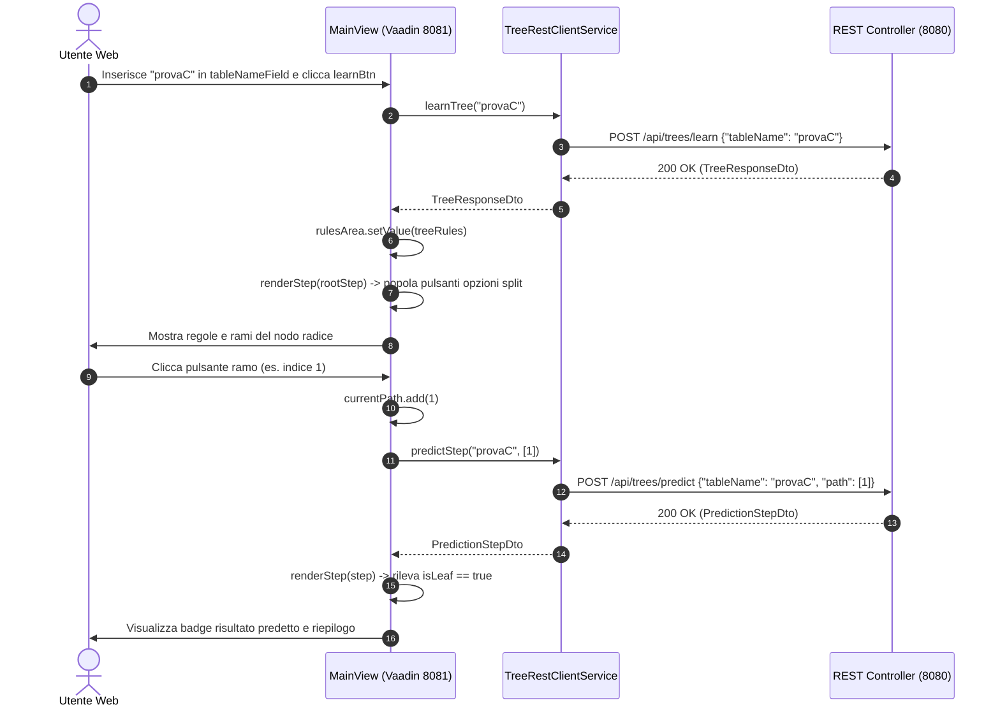

## 10. Diagramma di Sequenza 3: Protocollo Socket TCP Legacy (CLI - Porta 8080)

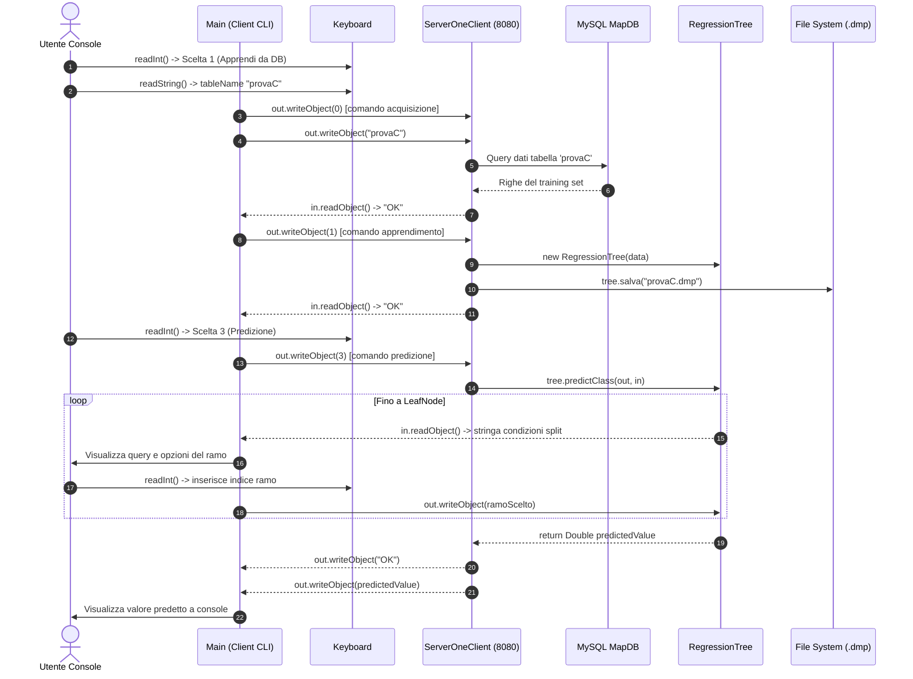

## 11. Diagramma di Deployment / Componenti (Porte 8080, 8081, 3306 MySQL MapDB)

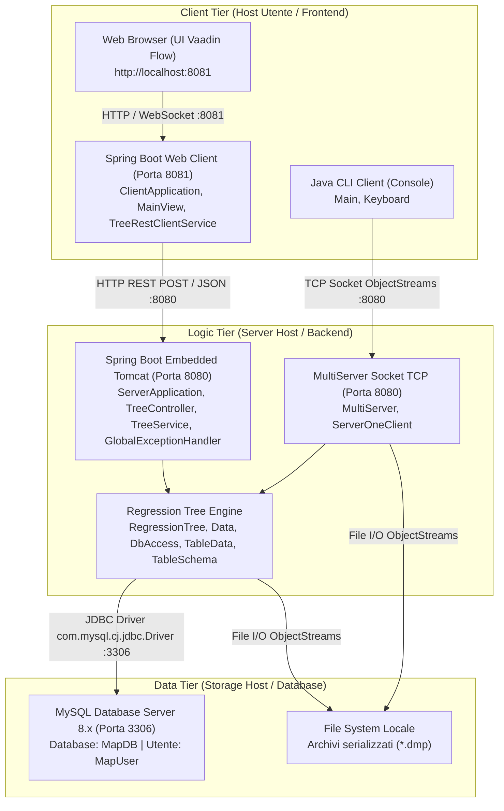
