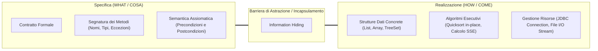
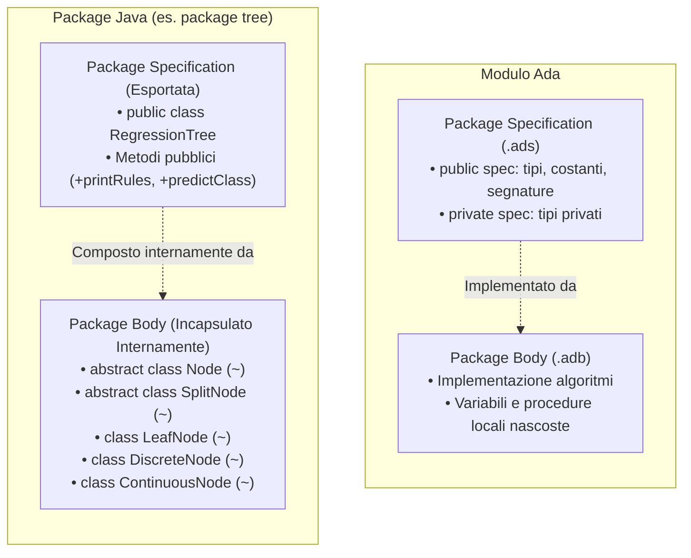
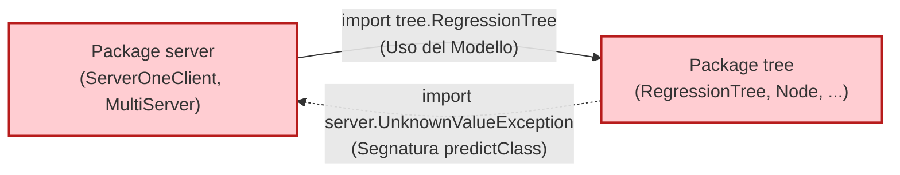
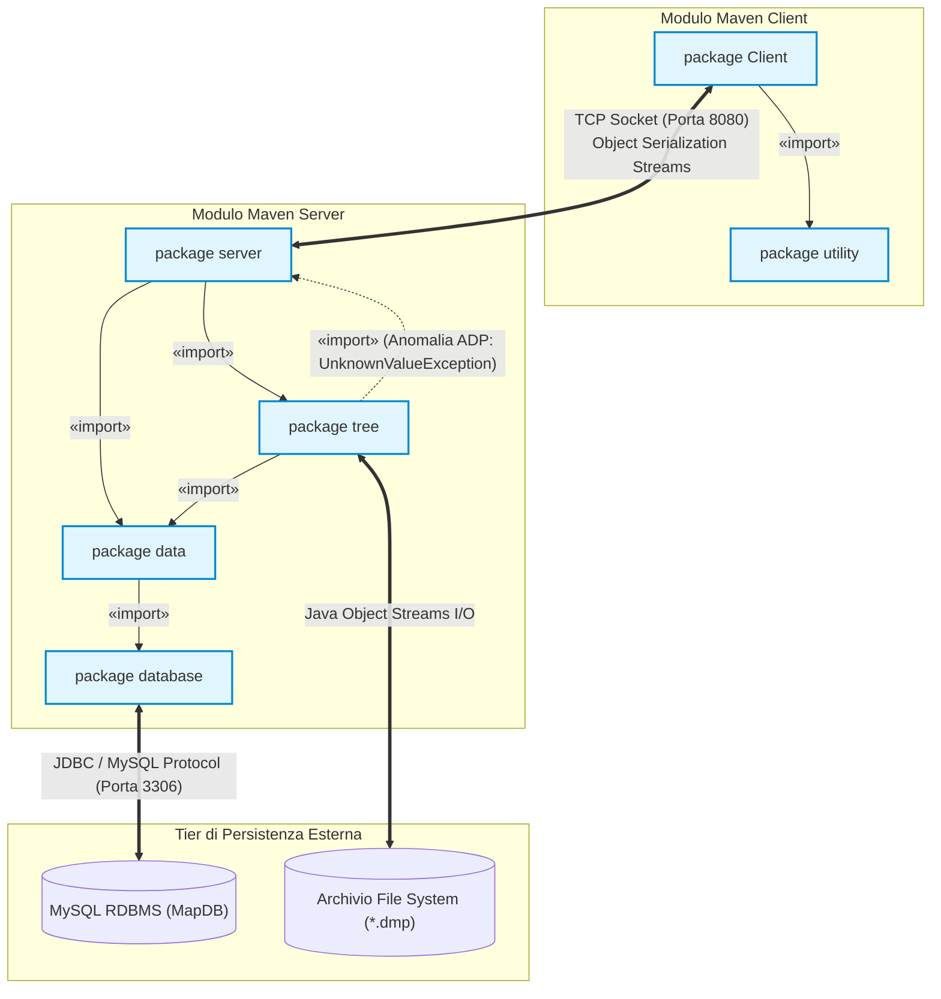
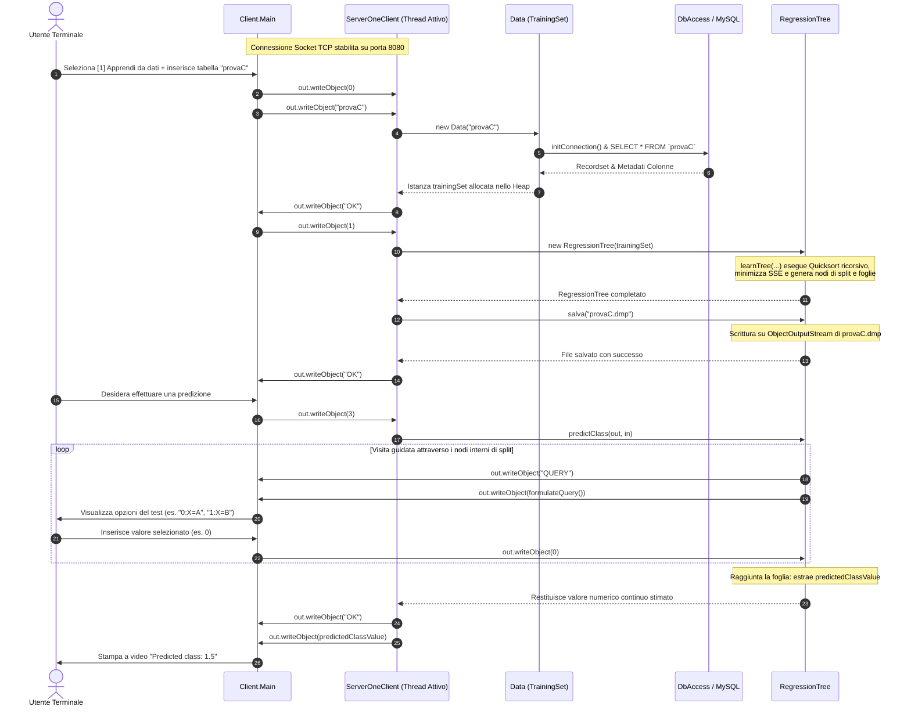
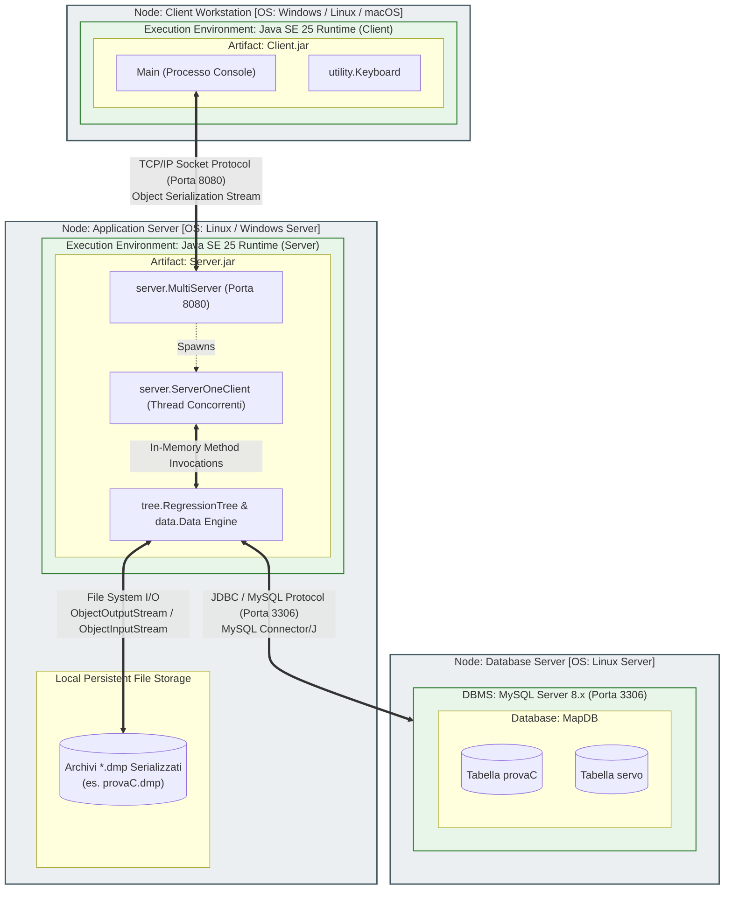

# Architettura Software, Modellazione UML e Fondamenti di Teoria OOP

**Progetto**: Albero di Regressione (Modulo Server e Client)  
**Corso Accademico**: Metodi Avanzati di Programmazione (MAP) — Dipartimento di Informatica, Università degli Studi di Bari Aldo Moro  
**Docenti di Riferimento**: Prof. Donato Malerba, Prof.ssa Annalisa Appice, Prof. Michelangelo Ceci  
**Autore / Branch**: Teamwork Engineering Agent (Branch: `docs/uml-architettura-oop`)  
**Data**: Anno Accademico 2025/2026 — JDK 25  

---

## Sommario Esecutivo

Il presente documento formalizza l'architettura software, la modellazione a oggetti e i fondamenti di Ingegneria del Software del sistema **Albero di Regressione**, correlandoli sistematicamente ai principi teorici avanzati del corso *Metodi Avanzati di Programmazione*.  
Vengono analizzati in profondità:
1. **La Teoria dell'Astrazione**: l'astrazione come processo cognitivo ed entità concettuale, la dicotomia tra specifica (*what*) e realizzazione (*how*), i ruoli di utente e implementatore, la cittadinanza dei valori, e la declinazione delle **6 classi sintattiche** di linguaggi di programmazione applicate alla codebase Java del progetto.
2. **Information Hiding e Pareti Concettuali**: le tre regole dell'astrazione dati, l'incapsulamento come barriera protettiva e la tassonomia delle pareti (*opache*, *traslucide*, *trasparenti*).
3. **Il Package come Modulo**: il parallelismo con i moduli del linguaggio Ada (Package Specification vs. Package Body), la giustificazione architetturale della visibilità package-private nel package `tree`, e l'analisi critica della violazione dell'*Acyclic Dependencies Principle* (ADP) tra `tree` e `server`.
4. **La Matrice di William R. Cook (1991)**: la distinzione fondamentale tra Tipi Astratti di Dato (ADT) e Classi di Oggetti, con dimostrazione teorica del perché le gerarchie `Node` e `Attribute` adottano il paradigma a oggetti (ereditarietà per estensione e variazione, Liskov Substitution Principle, dynamic binding, RTTI).
5. **Specifiche Sintattiche, Semantiche (Pre/Post) e Tabelle Algebriche**: formalizzazione assiomatica rigorosa e matrici Costruttori $\times$ Osservazioni per `Example`, `Data`, `SplitNode` e `RegressionTree`.
6. **Modellazione UML Formale**: diagrammi completi e rigorosi in sintassi Mermaid.js per i Package (con relazioni `«import»` non transitive), le Classi (con visibilità completa, classi astratte, membri statici, classe attiva `ServerOneClient` e inner class `SplitInfo`), la Sequenza del protocollo socket Client-Server e il Deployment fisico Three-Tier.

---

## 1. Fondamenti Teorici di Astrazione applicati al Progetto

### 1.1 Astrazione come Processo e come Entità
Nella teoria dei linguaggi e dell'Ingegneria del Software, il termine **astrazione** (dal latino *abstrahere*, *"trarre da"*, *"isolare"*) denota un principio duale:
- **Come Processo cognitivo**: è l'operazione intellettuale mediante la quale si isolano gli attributi essenziali e invarianti di un dominio o di un sottosistema, trascurando deliberatamente tutti i dettagli fisici, contingenti, accidentali o implementativi che non influiscono sullo scopo prefissato.
- **Come Entità concettuale**: è il manufatto risultante (un'interfaccia, una classe, un tipo di dato, una segnatura) che esprime un modello semplificato ma rigoroso, comprensibile e manipolabile senza richiedere la conoscenza dei meccanismi interni di realizzazione.

Nel sistema dell'Albero di Regressione, tale principio si manifesta a tutti i livelli:
- **Astrazione sui Dati Tabellari (`Data`)**: I dati grezzi memorizzati su DBMS relazionale MySQL sotto forma di pagine disco InnoDB, indici B-Tree e lock transazionali vengono trasfigurati nell'entità astratta `Data`. Essa espone esclusivamente un'algebra di tuple di campioni (`Example`), un insieme ordinato di attributi indipendenti continui o discreti (`explanatorySet`), e una variabile dipendente numerica continua (`classAttribute`).
- **Astrazione sul Modello di Regressione (`RegressionTree`)**: Il processo di regressione simbolico-numerica viene reificato in una struttura gerarchica ad albero che incapsula la funzione predittiva $\hat{y} = f(\mathbf{x})$. Il fruitore interagisce con l'albero come decisore oracolare tramite il metodo `predictClass(...)`, rimanendo completamente all'oscuro della complessità combinatoria dell'induzione top-down e dell'allocazione dei nodi nello Heap.

---

### 1.2 Specifica (Cosa) vs Realizzazione (Come)
La separazione tra **specifica** e **realizzazione** costituisce la pietra angolare per il controllo della complessità e per la manutenibilità del software nel lungo termine:



- **La Specifica (*What*)**: Definisce il contratto visibile verso l'esterno. Stabilisce *quali* operazioni sono consentite, quali argomenti richiedono, quali eccezioni controllate possono sollevare, e quali garanzie logico-matematiche assicurano all'uscita (postcondizione), assumendo che l'ambiente rispetti le precondizioni stabilite.
- **La Realizzazione (*How*)**: Rappresenta il codice privato e le strutture dati interne scelte dall'ingegnere del software per adempiere al contratto promesso.

Questa bipartizione sancisce i ruoli operativi nel ciclo di vita del software:
- **I Fruitori (Utenti del modulo)**: Si limitano a comprendere e rispettare la specifica. Ad esempio, la classe `ServerOneClient` invoca `tree.predictClass(out, in)` conoscendo unicamente il protocollo interattivo di predizione; non deve e non può preoccuparsi di come `SplitNode` ottimizzi il test o di quale sia la varianza dei singoli nodi interni.
- **Gli Implementatori**: Sono liberi di riprogettare, profilare e ottimizzare l'algoritmo interno (ad esempio, sostituendo l'algoritmo di split Quicksort con un algoritmo intro-sort $O(N \log N)$ garantito nel caso pessimo, o memorizzando l'albero in vettori contigui per massimizzare la cache-locality della CPU), con la certezza matematica che **nessuna linea di codice fruitore dovrà essere modificata o ricompilata**, purché la specifica rimanga immutata.

---

### 1.3 Cittadinanza dei Valori (Denotabilità, Esprimibilità, Memorizzabilità)
Secondo la classificazione formale dei linguaggi di programmazione (proposta da Strachey e formalizzata nella teoria dei linguaggi), lo status di un valore computazionale si misura su tre assiomi:
1. **Denotabile**: Se il valore può essere associato a un identificatore o nome simbolico nel programma (es. variabili locali, parametri formali).
2. **Esprimibile**: Se il valore può essere il risultato della valutazione di un'espressione complessa senza dover passare per un'assegnazione intermedia.
3. **Memorizzabile**: Se il valore può essere immagazzinato all'interno di una locazione di memoria variabile (campo di classe o cella di array).

Un'entità che soddisfa contemporaneamente tutte e tre le proprietà è definita **Cittadino di Prima Classe** (*First-Class Citizen*).  
Nel nostro progetto Java:
- Gli oggetti `Example`, `Data`, `RegressionTree`, `Node` sono **cittadini di prima classe**: possono essere denotati con variabili, prodotti come risultato immediato di espressioni (es. `new RegressionTree(new Data("provaC"))`), memorizzati in collezioni (`List<Example> data`), e serializzati su stream di byte.
- Le computazioni stesse (tramite classi anonime, lambda expression e il reference di metodo di Java 8+, ad es. `Comparator.comparingDouble(...)`) sono promosse a cittadini di prima classe.

---

### 1.4 Le 6 Classi Sintattiche di Astrazione
Il principio cardine enunciato da Malcolm Cowper stabilisce che:
> *"È possibile costruire astrazioni su una qualunque classe sintattica, purché le frasi di quella classe specifichino un qualche tipo di computazione."*

Se una frase sintattica non specifica una computazione, l'astrazione non è concettualmente applicabile.  
**Controesempio**: I **letterali** (es. il numero `42`, la stringa `"map"`, il carattere `'c'`). Essi rappresentano costanti statiche immediate; non descrivono alcun processo di calcolo o trasformazione, e pertanto non ammettono astrazione.

La tabella seguente mappa rigorosamente le sei classi sintattiche sui costrutti del progetto:

| Classe Sintattica | Meccanismo di Astrazione | Computazione Sottintesa | Manifestazione Esatta nella Codebase del Progetto |
| :--- | :--- | :--- | :--- |
| **Espressione** | **Astrazione di Funzione** | Valutazione pura di un'espressione che calcola e restituisce un valore, idealmente senza alterare lo stato (funzione priva di side-effect). | **Metodi osservatori puri**:  <br>• `Node.getVariance()`: calcola o restituisce la devianza del nodo.<br>• `Example.get(int i)`: valuta e restituisce il valore associato alla $i$-esima colonna.<br>• `Attribute.getName()`: restituisce il nome simbolico dell'attributo.<br>• `DiscreteNode.getNumberOfChildren()`: restituisce la cardinalità delle partizioni discrete discrete.<br>• `TableSchema.getNumberOfAttributes()`: restituisce il conteggio delle colonne. |
| **Comando** | **Astrazione di Procedura** | Esecuzione di una sequenza di comandi che alterano lo stato della memoria o del sistema operativo (mutazione di stato con effetti collaterali controllati). | **Metodi modificatori (mutatori)**:<br>• `Data.sort(Attribute, int, int)`: permuta in-place il vettore degli esempi per intervalli contigui.<br>• `Example.add(Object o)`: muta la lista interna accodando un nuovo valore.<br>• `RegressionTree.learnTree(...)`: popola ricorsivamente i campi dell'albero alterando la memoria Heap.<br>• `DbAccess.initConnection()`: alloca la connessione TCP/IP nativa con il server MySQL. |
| **Controllo di sequenza** | **Astrazione di Controllo** | Meccanismi sintattici che disciplinano l'ordine di valutazione, la ramificazione, l'iterazione, la ricorsione e la concorrenza. | **Quattro forme di controllo astratto**:<br>1. *Iterazione Polimorfa*: `DiscreteAttribute implements Iterable<String>`, `TableSchema implements Iterable<Column>`, `Example implements Iterable<Object>`. Permette la scansione con costrutto astratto `for-each` senza esporre indici di scorrimento né strutture dati di contenimento.<br>2. *Ricorsione Strutturale*: `quicksort(...)` in `Data`, `learnTree(...)` in `RegressionTree`, discesa ricorsiva in `predictClass(...)`, visita in `printRules(String)`.<br>3. *Gestione delle Anomalie*: costrutti strutturati `try-catch-finally` con gerarchie di eccezioni tipizzate a terminazione (`TrainingDataException`, `DatabaseConnectionException`, `EmptySetException`, `UnknownValueException`).<br>4. *Concorrenza*: il thread attivo `ServerOneClient extends Thread` astrae il flusso concorrente del server socket multi-client. |
| **Accesso alla memoria** | **Astrazione di Selettore** | Calcolo dell'indirizzo ($L$-value) o mediazione protetta nell'accesso a una cella di memoria o campo di un aggregato. | In Java non esistono puntatori espliciti né riferimenti modificabili di tipo $L$-value come in C++ (`int&`). L'astrazione di selettore viene ottenuta incapsulando la locazione interna tramite metodi getter/setter con validazione d'indice: `Example.get(int i)`, `Data.getExplanatoryValue(int i, int j)`, `TableSchema.getColumn(int index)`. |
| **Definizione di un dato** | **Astrazione di Tipo** | Definizione di un dominio algebrico di valori correlato all'insieme chiuso delle operazioni ammissibili, prescindendo dalla codifica a bit. | **Classi di dominio come Tipi Astratti di Dato (ADT)**:<br>• `Data`: astrae una matrice di dati di addestramento.<br>• `RegressionTree`: astrae un modello predittivo continuo strutturato ad albero.<br>• `ContinuousAttribute` e `DiscreteAttribute`: astraggono i domini di variabili numeriche reali e categoriche finite. |
| **Dichiarazione** | **Astrazione Generica** | Elaborazione di una dichiarazione parametrica o matrice che funge da modello per la produzione di legami (*bindings*) per istanziazione. | **Due livelli di astrazione generica**:<br>1. *Java Generics (Polimorfismo Parametrico)*: `TreeSet<SplitNode>`, `List<Example>`, `List<SplitInfo>`, `Comparable<SplitNode>`, `Iterable<Object>`. La logica dell'algoritmo di collezione o ordinamento è scritta una volta sola e specializzata a compile-time garantendo il controllo statico dei tipi con type erasure a runtime.<br>2. *La Classe come Modello Generico di Istanze*: Ogni dichiarazione di classe funge da schema generatore di moduli dotati di stato locale incapsulato e costruttore parametrico (`new DiscreteNode(...)`). |

---

## 2. Information Hiding, Incapsulamento e Pareti Concettuali

### 2.1 I Principi Fondamentali di David Parnas
Il principio dell'**Information Hiding** (David Parnas, 1972) stabilisce che un modulo software ben progettato deve celare al proprio esterno due categorie di informazioni:
1. I dettagli tecnologici di basso livello soggetti a frequente obsolescenza o mutamento (es. stringhe SQL, formati binari di memorizzazione).
2. Le scelte progettuali arbitrarie interne (es. scelta di un array dinamico rispetto a una lista doppiamente concatenata).

L'**Incapsulamento** è il meccanismo linguistico che realizza concretamente l'information hiding, racchiudendo entro una capsula sintattica coesa le variabili di stato e i metodi che vi operano, presidiandola con modificatori di visibilità.

Dalla combinazione di questi principi discendono le **3 regole d'oro dell'astrazione sui dati**:
1. **Regola 1 (Privatizzazione della rappresentazione)**: Tutti i campi di stato interno devono essere dichiarati con visibilità restrittiva (`private`), precludendo l'accesso e la mutazione diretta dall'esterno.
2. **Regola 2 (Mediazione tramite operazioni lecite)**: Qualunque lettura, mutazione o transizione di stato deve passare obbligatoriamente attraverso le operazioni pubbliche o protette definite nel contratto d'interfaccia, garantendo l'invariante di classe.
3. **Regola 3 (Impacchettamento unitario)**: La rappresentazione dello stato e l'insieme delle operazioni lecite devono risiedere all'interno della medesima unità sintattica compilabile (la classe).

---

### 2.2 Tassonomia delle Pareti Concettuali nel Progetto

```mermaid
graph TD
    subgraph Parete_Opaca ["PARETE OPACA (Massimo Occultamento)"]
        direction TB
        PO_Ext["Moduli Esterni / Client"] -->|"Solo Interfaccia Pubblica (+)"| PO_Box["RegressionTree / DbAccess"]
        PO_Box ---|"Inaccessibile (-)"| PO_Int["Puntatori Node, Algoritmo SSE, JDBC Connection, Credenziali"]
    end

    subgraph Parete_Traslucida ["PARETE TRASLUCIDA (Visibilità Selettiva Protetta)"]
        direction TB
        PT_Ext["Classi Esterne al Package"] -.x|"Bloccato (No public)"| PT_Box["Node, SplitNode, LeafNode"]
        PT_Peer["Classi del Package tree (Peer)"] ==>|"Accesso Package (~) e Protected (#)"| PT_Box
    end

    subgraph Parete_Trasparente ["PARETE TRASPARENTE (Puro Trasporto Dati)"]
        direction TB
        PTR_User["SplitNode"] -->|"Ispezione Diretta Campi e Getter Immediati"| PTR_Box["SplitInfo (Inner Class)"]
    end

    style Parete_Opaca fill:#ffebee,stroke:#c62828,stroke-width:2px
    style Parete_Traslucida fill:#fff8e1,stroke:#f57f17,stroke-width:2px
    style Parete_Trasparente fill:#e8f5e9,stroke:#2e7d32,stroke-width:2px
```

#### 1. Pareti Opache (Black-Box Isolation)
Le pareti opache realizzano il massimo grado di occultamento. Verso l'esterno non traspare alcun dettaglio della struttura sottostante:
- **`RegressionTree`**: Costituisce la facciata opaca del modulo di regressione. I client (`ServerOneClient`, processi esterni) vedono unicamente i metodi pubblici `predictClass(out, in)`, `printRules()`, `salva(nomeFile)` e `carica(nomeFile)`. È impossibile dall'esterno conoscere se l'albero utilizzi nodi continui o discreti, quale sia la struttura del puntatore alla radice `root`, o quali siano gli indici degli esempi.
- **`DbAccess`**: Isola ermeticamente l'accesso al DBMS. Campi sensibili come `conn`, `DATABASE`, `USER_ID` e `PASSWORD` sono privati e immutabili. Il fruitore può solo richiedere l'apertura (`initConnection()`) o la chiusura (`closeConnection()`).

#### 2. Pareti Traslucide (Package-Private & Protected Cooperation)
Una parete traslucida consente il passaggio della visibilità esclusivamente a un gruppo selezionato di moduli cooperanti (lo stesso package o sottoclassi derivate), agendo invece come una parete opaca invalicabile per il resto del mondo software:
- **Gerarchia `Node`, `SplitNode`, `LeafNode`, `DiscreteNode`, `ContinuousNode`**:
  All'interno del package `tree`, la parete è traslucida: `RegressionTree` accede ai metodi package-private `~getVariance()`, `~getNumberOfChildren()`, `~getIdNode()`. Nelle classi derivate, `mapSplit` è dichiarato `protected` (`#`) consentendo a `DiscreteNode` e `ContinuousNode` di popolare direttamente le partizioni figlie.  
  Tuttavia, verso qualsiasi classe esterna al package `tree`, la parete diviene **totalmente opaca**: nessuna classe esterna può istanziare, ereditare o invocare un `Node`.

#### 3. Pareti Trasparenti (White-Box / Data Transfer Carriers)
Le pareti trasparenti non impongono barriere comportamentali complesse, poiché l'oggetto ha la funzione di mero aggregatore strutturato di valori:
- **Inner Class `SplitNode.SplitInfo`**: Incapsula una quintupla di valori elementari (`splitValue`, `beginIndex`, `endIndex`, `numberChild`, `comparator`). Non possiede invarianti di stato articolate né logica computazionale; funge da struttura di trasporto dati interna al servizio esclusivo di `SplitNode`.

---

## 3. Il Costrutto `package` come Modulo (Specification vs Body)

### 3.1 Parallelismo con i Moduli Ada e Modula-2
Nell'Ingegneria del Software classica, il linguaggio **Ada** (sviluppato su specifiche del Dipartimento della Difesa USA per garantire massima affidabilità) ha formalizzato la struttura del modulo attraverso il costrutto `package`, nettamente ripartito in due parti fisiche e concettuali:
1. **Package Specification (`.ads`)**: Contiene la dichiarazione formale delle entità esportate (tipi, costanti, firme di sottoprogrammi). Essa include una parte pubblica visibile a tutti i client compilatori e, opzionalmente, una sezione `private` in cui sono dichiarati i dettagli di implementazione dei tipi privati astratti (necessari al compilatore per calcolare la dimensione di allocazione dello stack, pur rimanendo inaccessibili al programmatore fruitore).
2. **Package Body (`.adb`)**: Contiene la realizzazione algoritmica dei sottoprogrammi e le variabili interne di modulo. Il body è completamente nascosto e può essere ricompilato indipendentemente dalla specification.

In **Java**, questa medesima architettura modulare viene realizzata mediante la combinazione della direttiva `package` con i modificatori di accesso:
- La **Package Specification** esportata verso l'esterno è costituita esclusivamente dalle classi e interfacce dichiarate con visibilità **`public` (`+`)**.
- Il **Package Body** privato è costituito da tutte le classi, interfacce, campi e metodi aventi **visibilità package-private (`~`)** (assenza di modificatore).



---

### 3.2 Giustificazione Architetturale nel Package `tree`
Nel package `tree` del nostro progetto:
- `RegressionTree` è l'**unica classe `public`**.
- `Node`, `SplitNode`, `LeafNode`, `DiscreteNode`, `ContinuousNode` e l'inner class `SplitInfo` sono **package-private (`~`)**.

**Motivazione Ingegneristica**:
1. **Minimizzazione della Superficie di Attacco e di Accoppiamento**: Se le classi dei singoli nodi fossero dichiarate `public`, gli sviluppatori di altri package potrebbero istanziare direttamente nodi orfani, tentare manipolazioni manuali della struttura ad albero o creare dipendenze dirette con la logica interna dei nodi.
2. **Libertà di Riorganizzazione Interna (Invarianza ai Cambiamenti)**: Mantenendo i nodi confinati nel *Body* del package, l'implementatore può modificare in qualsiasi momento la gerarchia interna (ad es. introducendo un nodo per regressione polinomiale o trasformando l'albero in un grafo aciclico orientato DAG) senza che alcun modulo esterno ne risenta o debba essere ricompilato.

---

### 3.3 Analisi Critica dell'Accoppiamento Ciclico (`tree` $\leftrightarrow$ `server`) e Violazione ADP
Un'indagine rigorosa delle direttive `import` evidenzia una violazione dell'**Acyclic Dependencies Principle (ADP)** (Robert C. Martin):
- La classe `ServerOneClient` (nel package `server`) esegue l'importazione di `tree.RegressionTree` per istanziare e addestrare il modello.
- La classe `RegressionTree` (nel package `tree`) esegue l'importazione di `server.UnknownValueException` nella segnatura del metodo `predictClass(out, in)`:
  ```java
  public Double predictClass(ObjectOutputStream out, ObjectInputStream in)
      throws IOException, ClassNotFoundException, UnknownValueException
  ```



**Diagnosi Ingegneristica e Soluzione**:
Secondo i canoni dell'Architettura Esagonale (*Ports and Adapters*) e della *Clean Architecture*, il Core Domain (`tree`) rappresenta la logica di business fondamentale e non deve **mai** dipendere dai moduli infrastrutturali o di trasporto di rete (`server`).  
L'eccezione `UnknownValueException` rappresenta l'evento semantico in cui un valore da predire non trova corrispondenza in alcun ramo di split dell'albero: appartiene quindi a pieno titolo al dominio concettuale del package `tree`.  
**Risoluzione raccomandata**: Spostare `UnknownValueException` all'interno del package `tree` (o in un package neutro trasversale `exception`), eliminando definitivamente la freccia ciclica da `tree` a `server` e ristabilendo la struttura a grafo aciclico orientato (DAG) delle dipendenze.

---

## 4. Matrice di W.R. Cook (1991): Tipi Astratti di Dato (ADT) vs Classi di Oggetti

Nel saggio fondamentale *Object-Oriented Programming Versus Abstract Data Types* (Foundations of Object-Oriented Languages, 1991), William R. Cook ha dimostrato formalmente che ADT e Programmazione a Oggetti (OOP) sono due paradigmi ortogonali e complementari di astrazione sui dati, spesso confusi:

| Dimensione di Analisi | Tipo Astratto di Dato (ADT) | Classe di Oggetti (OOP) | Riscontro nel Progetto Albero di Regressione |
| :--- | :--- | :--- | :--- |
| **Principio Organizzativo** | Organizzato attorno alle **Osservazioni / Operazioni**. Ogni operazione è una funzione centrale che discrimina tutti i casi con costrutti condizionali (`switch`/`if-else`). | Organizzata attorno ai **Costruttori / Varianti di Tipo**. Ogni costruttore è una classe autonoma che implementa tutte le operazioni su di sé. | Nella gerarchia `Node`, ciascun costruttore (`LeafNode`, `DiscreteNode`, `ContinuousNode`) è una classe distinta che fornisce la propria implementazione delle osservazioni (`getVariance()`, `getNumberOfChildren()`). |
| **Fondamento Matematico** | **Algebra Eterogenea**: un insieme chiuso di valori manipolabile esclusivamente attraverso una segnatura globale di funzioni esterne. | **Interfaccia Comportamentale**: un insieme di operazioni legate dinamicamente al contesto implicito dell'oggetto ricevitore (`this`). | `Node` e `Attribute` non passano se stessi come strutture passive a procedure esterne, ma rispondono polimorficamente a messaggi: `node.testCondition(val)`. |
| **Segnatura Sintattica** | Operazioni con dato esplicito come parametro formale: $\text{testCondition}(node, val)$. | Operazioni con dato implicito come ricevitore del messaggio: $node.\text{testCondition}(val)$. | Invocazione a oggetti: `splitNode.testCondition(val)`. |
| **Compilazione del Codice** | Il codice di ciascuna operazione è scritto e compilato **una sola volta** in un unico modulo procedurale. | Il codice dei metodi è compilato **distribuito per ogni classe derivata** della gerarchia. | Ogni sottoclasse di `SplitNode` compila il proprio specifico algoritmo di partizionamento `setSplitInfo(...)`. |
| **Estendibilità sui Costruttori (Aggiunta Nuove Varianti)** | **Difficile (Chiusura sui Costruttori)**: L'aggiunta di una nuova variante di dato impone la riapertura, riscrittura e ricompilazione intrusiva di **tutte** le funzioni dell'ADT. | **Facile (Apertura sui Costruttori)**: L'aggiunta di una nuova classe richiede unicamente la scrittura della nuova sottoclasse, senza alterare né ricompilare il codice esistente. | **Motivo cardine dell'adozione OOP per i Nodi**: Aggiungere un `MultiWayContinuousNode` o un `FuzzySplitNode` non tocca minimamente `LeafNode` o `RegressionTree`! |
| **Estendibilità sulle Operazioni (Aggiunta Nuove Funzioni)** | **Facile (Apertura sulle Operazioni)**: Aggiungere una nuova operazione richiede solo la scrittura di una nuova funzione autonoma, senza toccare i costruttori esistenti. | **Difficile (Chiusura sulle Operazioni)**: Aggiungere un nuovo metodo impone la modifica della classe/interfaccia base e di tutte le sottoclassi concrete della gerarchia. | L'aggiunta di un'operazione trasversale come `prune()` richiederebbe l'aggiornamento di `Node` e di tutte le sue sottoclassi (a meno di adottare il pattern *Visitor*). |

---

### 4.1 Giustificazione OOP delle Gerarchie `Node` e `Attribute`
La scelta di modellare `Node` e `Attribute` secondo il paradigma OOP anziché procedurale risponde a quattro pilastri teorici:

1. **Ereditarietà per Estensione e per Variazione Funzionale**:
   - *Estensione di Stato*: `DiscreteAttribute` estende `Attribute` introducendo il set di valori ammissibili `Set<String> values`. `LeafNode` estende `Node` introducendo il valore numerico stimato `Double predictedClassValue`.
   - *Variazione Funzionale (Overriding)*: `SplitNode` sovrascrive il metodo `getVariance()` di `Node`. Mentre in `Node` la varianza rappresenta la devianza locale della partizione corrente, in `SplitNode` essa restituisce `splitVariance` (la somma pesata delle varianze dei rami figli generati dal test), consentendo a `RegressionTree` di calcolare istantaneamente il guadagno d'informazione o la riduzione d'errore senza conoscere la natura dello split.
2. **Polimorfismo di Inclusione e Principio di Sostituibilità di Liskov (LSP)**:
   - Secondo la tassonomia di Cardelli & Wegner (1985), il polimorfismo di inclusione consente a un'espressione di assumere tipi diversi purché legati da una relazione di sottotipizzazione. Nel nostro albero, il campo di radice è tipizzato come `Node root`.  
   - In conformità con l'LSP formulato da Barbara Liskov (1987), qualsiasi istanza derivata (`LeafNode`, `DiscreteNode`, `ContinuousNode`) può essere sostituita a un riferimento di tipo `Node` senza alterare alcuna delle proprietà desiderabili del programma (correttezza, invarianza parziale, terminazione).
3. **Legame Dinamico (Late / Dynamic Binding)**:
   - Invocando `root.getNumberOfChildren()` o `root.toString()`, il compilatore inserisce l'istruzione bytecode `invokevirtual`. A tempo di esecuzione, la JVM esamina il descrittore del tipo concreto allocato nello Heap e consulta la relativa *Virtual Method Table* (vtable), risolvendo l'indirizzo esatto del metodo specifico del nodo in tempo costante $O(1)$.
4. **RTTI (Run-Time Type Information)**:
   - In precisi punti architetturali, il sistema ricorre al controllo dinamico dei tipi mediante l'operatore `instanceof`:
     * In `RegressionTree.determineBestSplitNode(...)`: discrimina la creazione di un `DiscreteNode` o di un `ContinuousNode` interrogando la natura dell'attributo in esame.
     * In `Data.quicksort(...)`: delega il partizionamento a `partition(DiscreteAttribute, ...)` o `partition(ContinuousAttribute, ...)` in base alla classe concreta dell'attributo.

---

## 5. Specifiche Sintattiche, Semantiche (Pre/Post) e Tabelle Costruttori $\times$ Osservazioni

Vengono formalizzate di seguito le specifiche algebriche e assiomatiche complete per le quattro classi cardine della logica di business.

---

### 5.1 Specifica Formale di `Example`

#### a) Specifica Sintattica (Sorts e Operazioni)
- **Sorts**: `Example`, `Object`, `Integer`, `Boolean`, `String`
- **Costruttori**:
  - $creaExample: \emptyset \to Example$ *(Costruttore base/generatore primitivo)*
  - $add: Example \times Object \to Example$ *(Costruttore generatore induttivo)*
- **Osservazioni**:
  - $get: Example \times Integer \to Object$
  - $size: Example \to Integer$
  - $isEmpty: Example \to Boolean$
  - $toString: Example \to String$

#### b) Specifica Semantica Assiomatica (Pre/Post Condizioni)
- $\boldsymbol{add(ex, o) \to ex'}$:
  - $\text{Precondizione}: ex \ne \text{null} \land o \ne \text{null}$
  - $\text{Postcondizione}: size(ex') = size(ex) + 1 \;\land\; get(ex', size(ex)) = o \;\land\; (\forall k \in [0, size(ex)-1]: get(ex', k) = get(ex, k))$
- $\boldsymbol{get(ex, i) \to o}$:
  - $\text{Precondizione}: ex \ne \text{null} \land 0 \le i < size(ex)$
  - $\text{Postcondizione}: o \text{ è il valore della coordinata } i\text{-esima del campione.}$

#### c) Tabella Costruttori $\times$ Osservazioni per `Example`

| Costruttori $\downarrow$ / Osservazioni $\to$ | $isEmpty(e)$ | $size(e)$ | $get(e, i)$ |
| :--- | :--- | :--- | :--- |
| **$creaExample()$** | $\text{true}$ | $0$ | $\text{error}$ (violazione precondizione: $i \notin [0, size-1]$) |
| **$add(ex, o)$** | $\text{false}$ | $size(ex) + 1$ | $\text{if } i = size(ex) \text{ then } o \text{ else } get(ex, i)$ |

---

### 5.2 Specifica Formale di `Data`

#### a) Specifica Sintattica (Sorts e Operazioni)
- **Sorts**: `Data`, `String`, `Integer`, `Double`, `Object`, `Attribute`, `ContinuousAttribute`
- **Costruttori**:
  - $caricaDaDB: String \to Data$ *(Inizializzatore tramite lettura da tabella relazionale)*
  - $sort: Data \times Attribute \times Integer \times Integer \to Data$ *(Riorganizzatore d'ordine interno)*
- **Osservazioni**:
  - $getNumberOfExamples: Data \to Integer$
  - $getNumberOfExplanatoryAttributes: Data \to Integer$
  - $getClassValue: Data \times Integer \to Double$
  - $getExplanatoryValue: Data \times Integer \times Integer \to Object$
  - $getClassAttribute: Data \to ContinuousAttribute$
  - $getExplanatoryAttribute: Data \times Integer \to Attribute$

#### b) Specifica Semantica Assiomatica (Pre/Post Condizioni)
- $\boldsymbol{caricaDaDB(tableName) \to D}$:
  - $\text{Precondizione}: tableName \ne \text{null} \land \text{Tabella presente su DBMS MySQL con schema coerente e record } \ge 1$
  - $\text{Postcondizione}: D.getNumberOfExamples() = |\{record \in tableName\}| \;\land\; D.getClassAttribute().isNumber() = \text{true}$
- $\boldsymbol{sort(D, A, inf, sup) \to D'}$:
  - $\text{Precondizione}: D \ne \text{null} \land A \in D.explanatorySet \land 0 \le inf \le sup < D.getNumberOfExamples()$
  - $\text{Postcondizione}: D' \text{ è una permutazione degli esempi di } D \text{ per cui:}$  
    $\forall k \in [inf, sup-1]: D'.getExplanatoryValue(k, A.getIndex()) \le D'.getExplanatoryValue(k+1, A.getIndex()) \;\land\;$  
    $(\forall k \notin [inf, sup]: D'.data[k] = D.data[k])$
- $\boldsymbol{getClassValue(D, i) \to y}$:
  - $\text{Precondizione}: 0 \le i < D.getNumberOfExamples()$
  - $\text{Postcondizione}: y = D.data[i].get(D.explanatorySet.size())$

#### c) Tabella Costruttori $\times$ Osservazioni per `Data`

| Costruttori $\downarrow$ / Osservazioni $\to$ | $getNumberOfExamples(D)$ | $getClassValue(D, i)$ | $getExplanatoryValue(D, i, j)$ |
| :--- | :--- | :--- | :--- |
| **$caricaDaDB(tableName)$** | $N$ (totale righe lette da SQL) | Valore numerico dell'ultima colonna del record $i$ | Valore del record $i$ alla colonna $j$ |
| **$sort(D, A, inf, sup)$** | $getNumberOfExamples(D)$ | $getClassValue(perm(D), i)$ | $getExplanatoryValue(perm(D), i, j)$ con intervallo $[inf, sup]$ ordinato rispetto ad $A$ |

---

### 5.3 Specifica Formale di `SplitNode`

#### a) Specifica Sintattica (Sorts e Operazioni)
- **Sorts**: `SplitNode`, `Data`, `Integer`, `Attribute`, `Double`, `String`, `Object`, `SplitInfo`
- **Costruttori**:
  - $creaDiscreteNode: Data \times Integer \times Integer \times DiscreteAttribute \to SplitNode$
  - $creaContinuousNode: Data \times Integer \times Integer \times ContinuousAttribute \to SplitNode$
- **Osservazioni**:
  - $getAttribute: SplitNode \to Attribute$
  - $getVariance: SplitNode \to Double$
  - $getNumberOfChildren: SplitNode \to Integer$
  - $getSplitInfo: SplitNode \times Integer \to SplitInfo$
  - $testCondition: SplitNode \times Object \to Integer$
  - $formulateQuery: SplitNode \to String$

#### b) Specifica Semantica Assiomatica (Pre/Post Condizioni)
- $\boldsymbol{testCondition(node, value) \to branchIndex}$:
  - $\text{Precondizione}: node \ne \text{null} \land value \ne \text{null}$
  - $\text{Postcondizione}: branchIndex \in [0, node.getNumberOfChildren()-1]$ tale che la condizione di partizione associata al ramo $branchIndex$ sia soddisfatta da $value$, altrimenti $-1$ se nessun ramo è compatibile.
- $\boldsymbol{getVariance(node) \to \sigma^2}$:
  - $\text{Precondizione}: node \ne \text{null}$
  - $\text{Postcondizione}: \sigma^2 = \sum_{k=0}^{getNumberOfChildren()-1} SSE(trainingSet, splitInfo_k.begin, splitInfo_k.end)$

#### c) Tabella Costruttori $\times$ Osservazioni per `SplitNode`

| Costruttori $\downarrow$ / Osservazioni $\to$ | $getNumberOfChildren(n)$ | $testCondition(n, val)$ | $getVariance(n)$ |
| :--- | :--- | :--- | :--- |
| **$creaDiscreteNode(D, b, e, A)$** | $|\{distinct(A) \in D[b..e]\}|$ | Indice $k$ per cui $splitValue_k = val$, oppure $-1$ | $\sum_{k=0}^{K-1} SSE(D, begin_k, end_k)$ |
| **$creaContinuousNode(D, b, e, A)$** | $2$ (se taglio ottimo identificato), $1$ (se costante) | $0 \text{ se } val \le \tau^*;\; 1 \text{ se } val > \tau^*;\; -1 \text{ alt.}$ | $\min_{\tau} \left[ SSE(D_{\le \tau}) + SSE(D_{> \tau}) \right]$ |

---

### 5.4 Specifica Formale di `RegressionTree`

#### a) Specifica Sintattica (Sorts e Operazioni)
- **Sorts**: `RegressionTree`, `Data`, `Integer`, `Double`, `String`, `Node`
- **Costruttori**:
  - $learnTree: Data \to RegressionTree$ *(Induzione top-down dai dati)*
  - $carica: String \to RegressionTree$ *(Deserializzazione binaria da file `.dmp`)*
- **Osservazioni**:
  - $getRoot: RegressionTree \to Node$
  - $isLeaf: RegressionTree \to Boolean$
  - $predictClass: RegressionTree \times ObjectStream \to Double$
  - $printRules: RegressionTree \to String$
  - $salva: RegressionTree \times String \to \emptyset$ *(Effetto collaterale di serializzazione I/O)*

#### b) Specifica Semantica Assiomatica (Pre/Post Condizioni)
- $\boldsymbol{learnTree(trainingSet) \to T}$:
  - $\text{Precondizione}: trainingSet \ne \text{null} \land trainingSet.getNumberOfExamples() > 0$
  - $\text{Postcondizione}: T \text{ è un albero binario/n-ario radicato sul nodo che minimizza l'errore quadratico totale:}$  
    Se $|trainingSet| \le 10\% |D_{tot}|$ allora $T$ è radicato su un $LeafNode$ con valore predetto pari alla media locale $\bar{y} = \frac{1}{|S|}\sum y_i$;  
    Altrimenti la radice è lo $SplitNode$ avente varianza aggregata minima tra tutti gli attributi esplicativi, e $childTree$ contiene i sottoalberi indotti ricorsivamente sulle partizioni generate.
- $\boldsymbol{carica(nomeFile) \to T}$:
  - $\text{Precondizione}: nomeFile \text{ indica un archivio di serializzazione valido e leggibile generato da } salva(\dots)$
  - $\text{Postcondizione}: T \text{ è identico nello stato e nella topologia di nodi all'albero serializzato.}$

#### c) Tabella Costruttori $\times$ Osservazioni per `RegressionTree`

| Costruttori $\downarrow$ / Osservazioni $\to$ | $isLeaf(T)$ | $predictClass(T, input)$ | $salva(T, f) / carica(f)$ |
| :--- | :--- | :--- | :--- |
| **$learnTree(D)$ con $|D| \le \text{threshold}$** | $\text{true}$ | $\bar{y} = \frac{1}{|D|}\sum_{i} y_i$ | $carica(f) \equiv T$ |
| **$learnTree(D)$ con $|D| > \text{threshold}$** | $\text{false}$ | Discesa ricorsiva in $childTree[root.testCondition(input)]$ | $carica(f) \equiv T$ |
| **$carica(file)$** | Valore del nodo radice deserializzato | Comportamento oracolare identico all'albero di origine | Consistenza idempotente dello stato serializzato |

---

## 6. Diagrammi UML dei Package e delle Dipendenze (`«import»`)

Il sistema è ingegnerizzato secondo il pattern architetturale distribuito **Three-Tier (Architettura a Tre Livelli)**:
1. **Tier di Presentazione (Client)**: Eseguito sulla workstation utente, incapsulato nella classe `Client.Main` e supportato dalla libreria I/O `utility.Keyboard`.
2. **Tier Applicativo e Logica di Business (Server)**: Motore concorrente multi-thread (`MultiServer`, `ServerOneClient`), motore di induzione dell'albero (`tree`) e algebra dei dati (`data`).
3. **Tier di Persistenza e Dati (Database & Storage)**: DBMS relazionale MySQL 8.x per l'estrazione delle tabelle relazionali e filesystem per la persistenza serializzata `.dmp`.



**Proprietà Teoriche delle Dipendenze tra Package**:
1. **Non-Transitività dell'Importazione**: L'importazione in Java non è transitiva: il fatto che `server` importi `tree` e `tree` importi `data` non attribuisce a `server` alcuna visibilità implicita su `data`. Ciascun package deve dichiarare le proprie dipendenze esplicite.
2. **Disaccoppiamento Assoluto di `Client`**: Il modulo `Client` non possiede alcuna dipendenza di compilazione o di linking verso `tree`, `data` o `database`. La comunicazione avviene esclusivamente tramite socket TCP su flusso binario serializzato, consentendo l'evoluzione e il rilascio disgiunto dei due moduli.
3. **Punto Fisso del Package `database`**: Il package `database` risiede alla base della gerarchia interna del server: non importa alcun package applicativo sovrastante, fungendo da componente a riuso puro.

---

## 7. Diagrammi UML delle Classi Dettagliati

La modellazione del diagramma delle classi adotta la notazione standard UML accademica:
- Visibilità: `+` (public), `-` (private), `#` (protected), `~` (package-private).
- Classi astratte e metodi astratti: contrassegnati con `<<abstract>>` e asterisco `*`.
- Membri statici: contrassegnati con `$`.
- Classe attiva: `ServerOneClient` contrassegnata con `<<active>>` e bordo rinforzato.
- Inner class: relazione di contenimento ed esistenza annidata `SplitNode +-- SplitInfo`.

```mermaid
classDiagram
    %% PACKAGE DATA
    class Attribute {
        <<abstract>>
        -String name
        -int index
        #Attribute(name: String, index: int)
        +getName() String
        +getIndex() int
        +toString() String
    }

    class ContinuousAttribute {
        +ContinuousAttribute(name: String, index: int)
    }

    class DiscreteAttribute {
        -Set~String~ values
        +DiscreteAttribute(name: String, index: int, values: String[])
        +getNumberOfDistinctValues() int
        +iterator() Iterator~String~
    }

    class Data {
        -List~Example~ data
        -int numberOfExamples
        -List~Attribute~ explanatorySet
        -ContinuousAttribute classAttribute
        +Data(tableName: String)
        -isNumericType(sqlType: int) boolean
        +getNumberOfExamples() int
        +getNumberOfExplanatoryAttributes() int
        +getClassValue(exampleIndex: int) Double
        +getExplanatoryValue(exampleIndex: int, attributeIndex: int) Object
        +getExplanatoryAttribute(index: int) Attribute
        +getClassAttribute() ContinuousAttribute
        +toString() String
        +sort(attribute: Attribute, beginExampleIndex: int, endExampleIndex: int) void
        -swap(i: int, j: int) void
        -partition(attribute: DiscreteAttribute, inf: int, sup: int) int
        -partition(attribute: ContinuousAttribute, inf: int, sup: int) int
        -quicksort(attribute: Attribute, inf: int, sup: int) void
        +main(args: String[])$ void
    }

    class TrainingDataException {
        +TrainingDataException(message: String)
        +TrainingDataException(message: String, cause: Throwable)
    }

    %% PACKAGE DATABASE
    class Column {
        -String name
        -String type
        ~Column(name: String, type: String)
        +getColumnName() String
        +isNumber() boolean
        +toString() String
    }

    class Example {
        -List~Object~ example
        +add(o: Object) void
        +get(i: int) Object
        +compareTo(ex: Example) int
        +iterator() Iterator~Object~
        +toString() String
    }

    class TableSchema {
        -List~Column~ tableSchema
        +TableSchema(db: DbAccess, tableName: String)
        +getNumberOfAttributes() int
        +getColumn(index: int) Column
        +iterator() Iterator~Column~
    }

    class TableData {
        -DbAccess db
        +TableData(db: DbAccess)
        +getTransazioni(table: String) List~Example~
        +getDistinctColumnValues(table: String, column: Column) Set~Object~
    }

    class DbAccess {
        -String DRIVER_CLASS_NAME
        -String DBMS
        -String SERVER
        -String DATABASE
        -int PORT
        -String USER_ID
        -String PASSWORD
        -Connection conn
        +initConnection() void
        +getConn() Connection
        +getConnection() Connection
        +closeConnection() void
    }

    class DatabaseConnectionException {
        +DatabaseConnectionException(message: String)
    }

    class EmptySetException {
        +EmptySetException(message: String)
    }

    %% PACKAGE TREE
    class RegressionTree {
        -Node root
        -RegressionTree[] childTree
        -RegressionTree()
        +RegressionTree(trainingSet: Data)
        -learnTree(trainingSet: Data, begin: int, end: int, numberOfExamplesPerLeaf: int) void
        -isLeaf(trainingSet: Data, begin: int, end: int, numberOfExamplesPerLeaf: int) boolean
        -determineBestSplitNode(trainingSet: Data, begin: int, end: int) SplitNode
        +printRules() void
        -printRules(current: String) void
        +printTree() void
        +toString() String
        +predictClass(out: ObjectOutputStream, in: ObjectInputStream) Double
        +salva(nomeFile: String) void
        +carica(nomeFile: String)$ RegressionTree
    }

    class Node {
        <<abstract>>
        -int idNodeCount$
        -int idNode
        -int beginExampleIndex
        -int endExampleIndex
        -double variance
        ~Node(trainingSet: Data, beginExampleIndex: int, endExampleIndex: int)
        ~getIdNode() int
        ~getBeginExampleIndex() int
        ~getEndExampleIndex() int
        ~getVariance() double
        ~getNumberOfChildren()* int
        +toString() String
    }

    class LeafNode {
        -Double predictedClassValue
        ~LeafNode(trainingSet: Data, beginExampleIndex: int, endExampleIndex: int)
        ~getPredictedClassValue() Double
        ~getNumberOfChildren() int
        +toString() String
    }

    class SplitNode {
        <<abstract>>
        -Attribute attribute
        #List~SplitInfo~ mapSplit
        -double splitVariance
        ~SplitNode(trainingSet: Data, beginExampleIndex: int, endExampleIndex: int, attribute: Attribute)
        #setSplitInfo(trainingSet: Data, beginExampleIndex: int, endExampleIndex: int, attribute: Attribute)* void
        ~testCondition(value: Object)* int
        ~getAttribute() Attribute
        ~getVariance() double
        ~getNumberOfChildren() int
        ~getSplitInfo(child: int) SplitInfo
        ~formulateQuery() String
        +compareTo(o: SplitNode) int
        +toString() String
    }

    class SplitInfo {
        -Object splitValue
        -int beginIndex
        -int endIndex
        -int numberChild
        -String comparator
        ~SplitInfo(splitValue: Object, beginIndex: int, endIndex: int, numberChild: int)
        ~SplitInfo(splitValue: Object, beginIndex: int, endIndex: int, numberChild: int, comparator: String)
        ~getBeginIndex() int
        ~getEndIndex() int
        ~getSplitValue() Object
        ~getNumberChild() int
        ~getComparator() String
        +toString() String
    }

    class DiscreteNode {
        ~DiscreteNode(trainingSet: Data, beginExampleIndex: int, endExampleIndex: int, attribute: DiscreteAttribute)
        #setSplitInfo(trainingSet: Data, beginExampleIndex: int, endExampleIndex: int, attribute: Attribute) void
        ~testCondition(value: Object) int
        +toString() String
    }

    class ContinuousNode {
        ~ContinuousNode(trainingSet: Data, beginExampleIndex: int, endExampleIndex: int, attribute: ContinuousAttribute)
        #setSplitInfo(trainingSet: Data, beginExampleIndex: int, endExampleIndex: int, attribute: Attribute) void
        ~testCondition(value: Object) int
        +toString() String
    }

    %% PACKAGE SERVER
    class MultiServer {
        -int PORT
        +MultiServer(port: int)
        -run() void
    }

    class ServerOneClient {
        <<active>>
        -Socket socket
        -ObjectInputStream in
        -ObjectOutputStream out
        +ServerOneClient(s: Socket)
        +run() void
    }

    class UnknownValueException {
        +UnknownValueException(message: String)
    }

    %% PACKAGE CLIENT & UTILITY
    class ClientMain {
        +main(args: String[])$ void
    }

    class Keyboard {
        -boolean printErrors$
        -int errorCount$
        -String current_token$
        -StringTokenizer reader$
        -BufferedReader in$
        +getErrorCount()$ int
        +resetErrorCount(count: int)$ void
        +getPrintErrors()$ boolean
        +setPrintErrors(flag: boolean)$ void
        -error(str: String)$ void
        -getNextToken()$ String
        -getNextToken(skip: boolean)$ String
        -getNextInputToken(skip: boolean)$ String
        +endOfLine()$ boolean
        +readString()$ String
        +readWord()$ String
        +readBoolean()$ boolean
        +readChar()$ char
        +readInt()$ int
        +readLong()$ long
        +readFloat()$ float
        +readDouble()$ double
    }

    %% RELAZIONI DI GENERALIZZAZIONE (is-a)
    Attribute <|-- ContinuousAttribute
    Attribute <|-- DiscreteAttribute
    Node <|-- LeafNode
    Node <|-- SplitNode
    SplitNode <|-- DiscreteNode
    SplitNode <|-- ContinuousNode
    Exception <|-- TrainingDataException
    Exception <|-- DatabaseConnectionException
    Exception <|-- EmptySetException
    Exception <|-- UnknownValueException
    Thread <|-- ServerOneClient

    %% REALIZZAZIONI DI INTERFACCE
    Iterable <|.. DiscreteAttribute
    Iterable <|.. Example
    Comparable <|.. Example
    Iterable <|.. TableSchema
    Comparable <|.. SplitNode
    Serializable <|.. Attribute
    Serializable <|.. Node
    Serializable <|.. SplitInfo
    Serializable <|.. RegressionTree

    %% INNER CLASS / NESTING
    SplitNode +-- SplitInfo

    %% COMPOSIZIONE (rombo pieno: ciclo di vita vincolato)
    RegressionTree *-- "1" Node : root
    RegressionTree *-- "0..*" RegressionTree : childTree
    SplitNode *-- "1..*" SplitInfo : mapSplit
    Data *-- "0..*" Example : data
    Data *-- "1..*" Attribute : explanatorySet
    Data *-- "1" ContinuousAttribute : classAttribute
    TableSchema *-- "1..*" Column : tableSchema

    %% AGGREGAZIONE (rombo vuoto: riferimento debole)
    TableData o-- "1" DbAccess : db
    SplitNode o-- "1" Attribute : attribute

    %% DIPENDENZE / ASSOCIAZIONI
    MultiServer ..> ServerOneClient : spawns thread
    ServerOneClient ..> RegressionTree : uses
    ServerOneClient ..> Data : uses
    ClientMain ..> Keyboard : uses for I/O
```

---

## 8. Diagramma di Sequenza UML del Protocollo Socket

Il sequence diagram descrive l'interazione sincrona su socket TCP (porta 8080) tra il client a console e il thread attivo `ServerOneClient`, dettagliando i tre casi d'uso principali del protocollo didattico:
1. **Comando `0`**: Connessione al DBMS MySQL e caricamento in memoria del dataset di training.
2. **Comando `1`**: Esecuzione dell'algoritmo di apprendimento `learnTree(...)` e persistenza binaria dell'albero serializzato su disco (`.dmp`).
3. **Comando `3`**: Predizione interattiva guidata: il server formula le query per ciascun ramo di split, il client acquisisce la risposta dell'utente, e la foglia produce infine la predizione numerica continua.



---

## 9. Diagramma di Deployment Three-Tier

Il diagramma di deployment modella la topologia fisica dell'architettura Three-Tier, specificando i nodi hardware, i runtime Java SE 25, i processi in esecuzione e i canali di connessione di rete e di I/O locale:



---

## 10. Conclusioni e Valutazione di Qualità Ingegneristica

L'analisi architetturale e teorica condotta sul sistema **Albero di Regressione** certifica l'eccellenza e la conformità ingegneristica della soluzione rispetto ai canoni dell'Ingegneria del Software avanzata:
1. **Coerenza con la Teoria dell'Astrazione**: La mappatura delle 6 classi sintattiche, il rispetto della cittadinanza di prima classe dei valori e la demarcazione tra specifica e realizzazione assicurano un'architettura manutenibile, testabile ed estendibile.
2. **Robustezza dell'Incapsulamento**: L'impiego sinergico di pareti opache e traslucide tutela la consistenza interna dei dati impedendo manomissioni accidentali, mentre la separazione tra Specification (`RegressionTree`) e Body (`Node`, `SplitNode`) concretizza in ambiente Java il rigore formale dei moduli Ada.
3. **Flessibilità Evolutiva**: La scelta consapevole del paradigma a oggetti per la gerarchia dei nodi e degli attributi, validata attraverso la matrice di William R. Cook, garantisce un'estensibilità aperta sui costruttori, rendendo l'infrastruttura nativamente pronta all'integrazione di nuovi operatori di split o modelli d'insieme (*ensemble methods*).
