# Diagrammi UML e Architettura dei Package

## 1. Architettura dei Package e Dipendenze («import»)

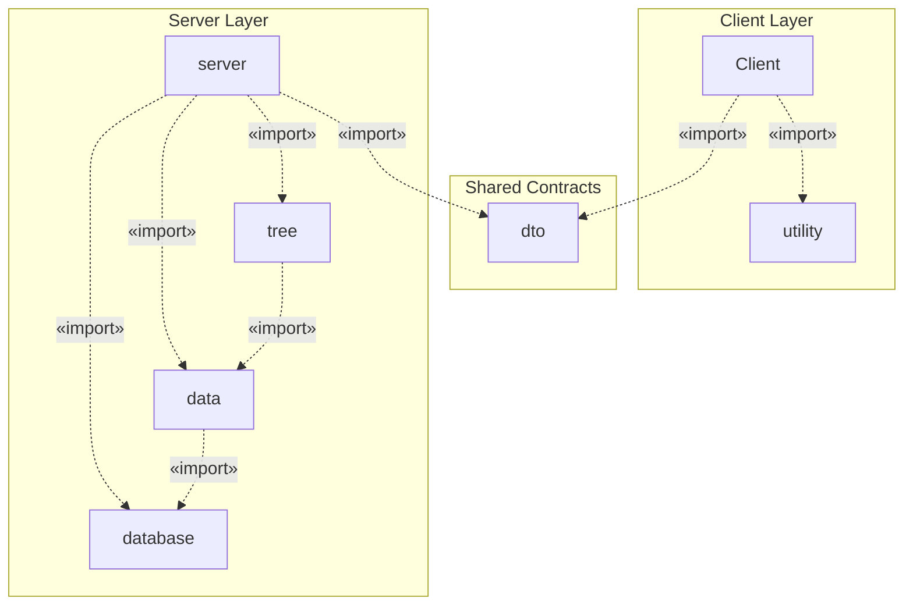

## 2. Diagramma UML delle Classi — Package `data`

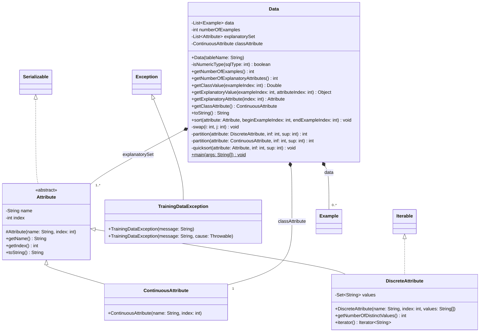

## 3. Diagramma UML delle Classi — Package `database`

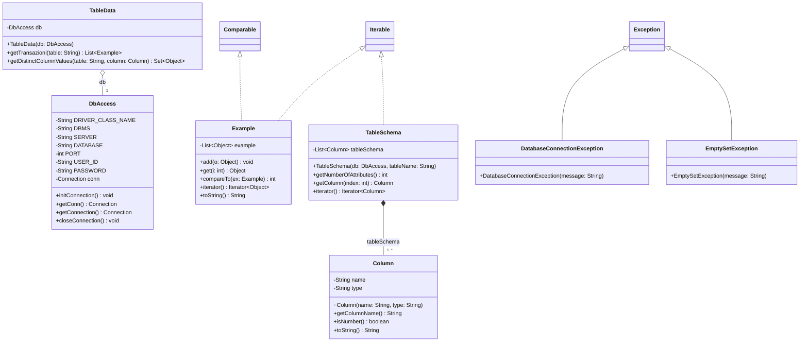

## 4. Diagramma UML delle Classi — Package `tree`

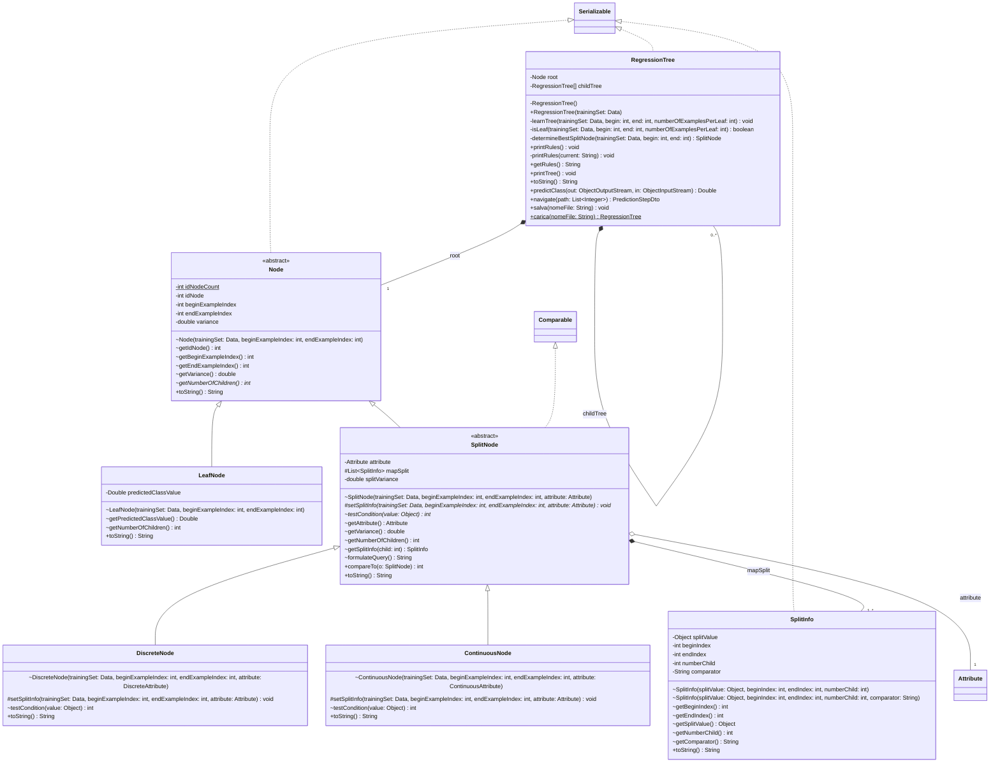

## 5. Diagramma UML delle Classi — Package `server`, `Client` e `utility`

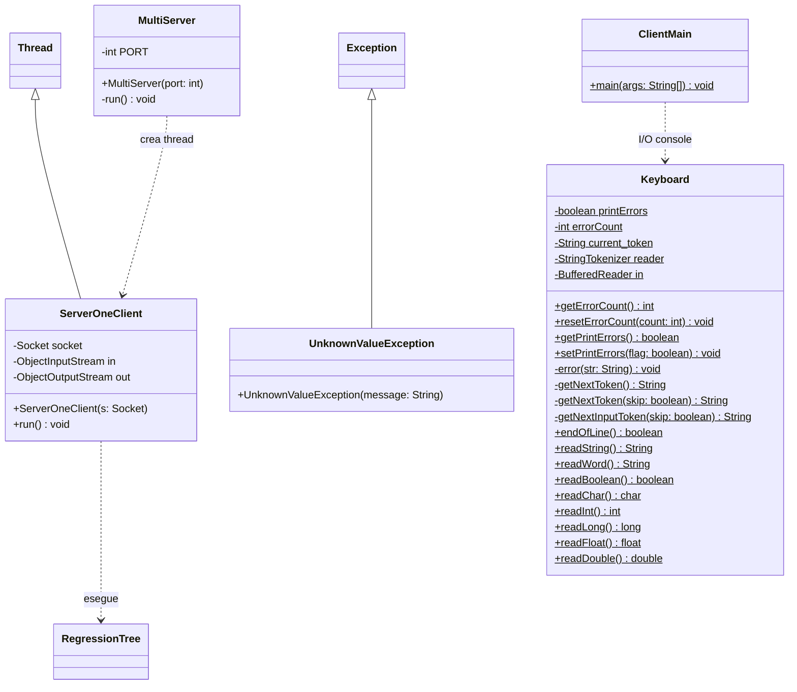

## 6. Diagramma UML delle Classi — Package `dto` (Contratti JSON)

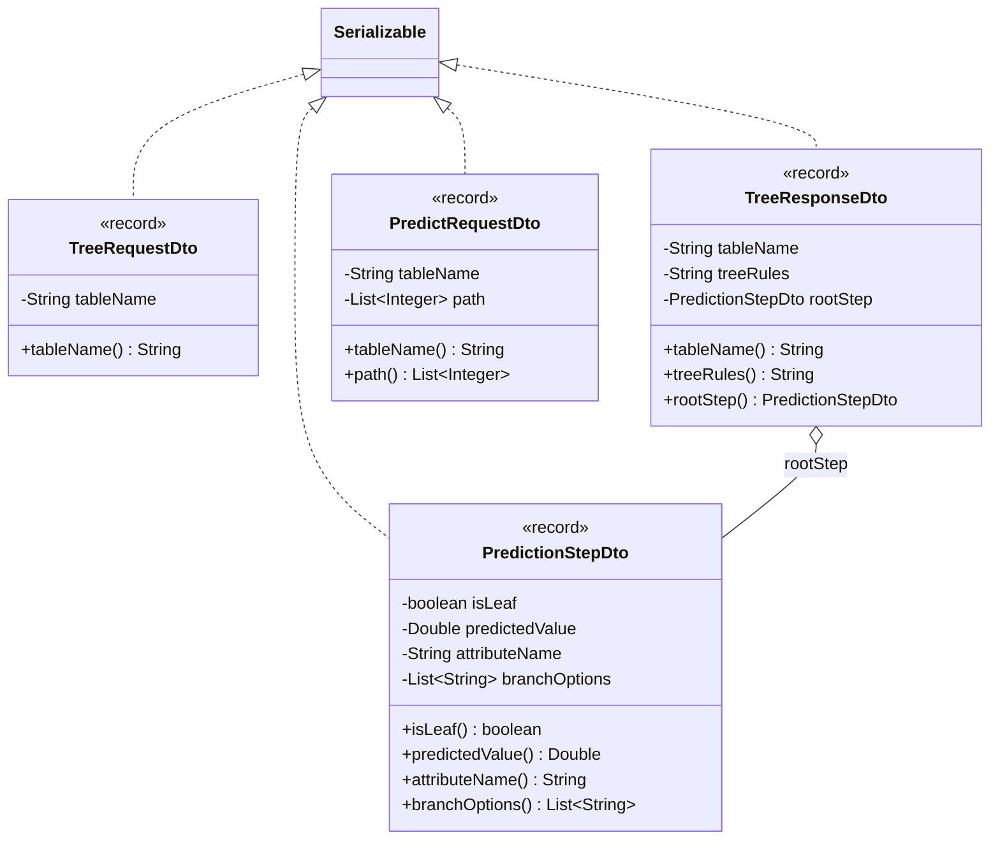

## 7. Diagramma UML delle Classi — Componenti Spring Boot REST e Vaadin Flow

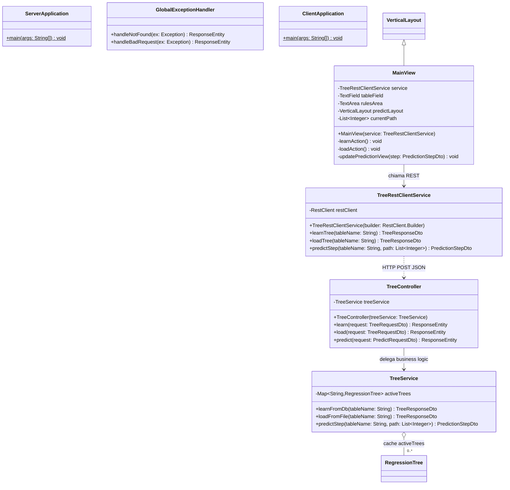

## 8. Diagramma UML Panoramico delle Relazioni tra Classi Principali

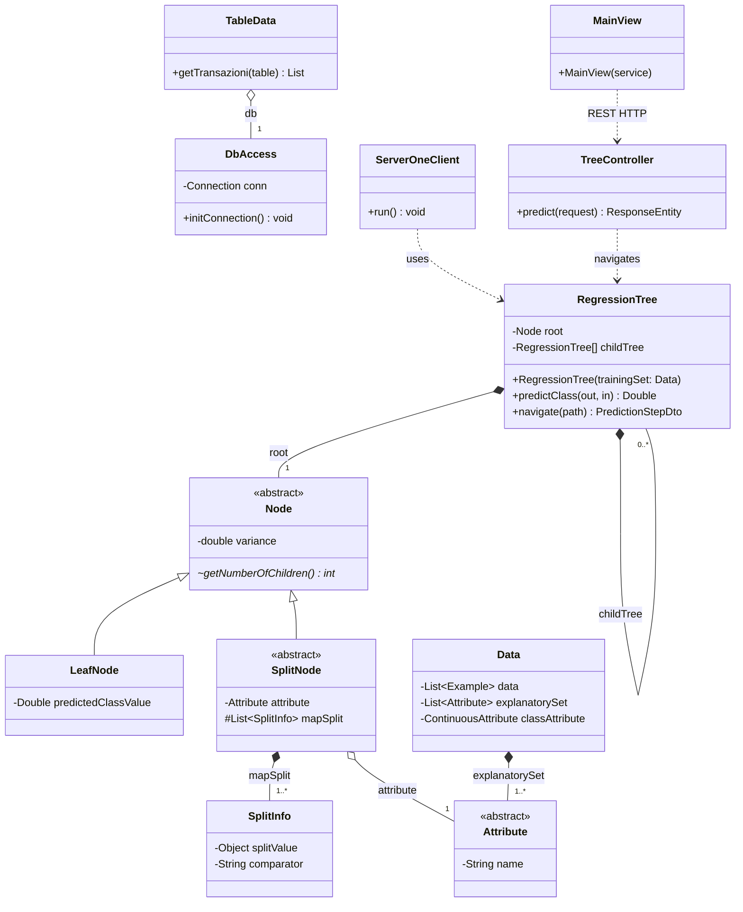

## 9. Diagramma di Sequenza UML — Protocollo Socket Multi-Client

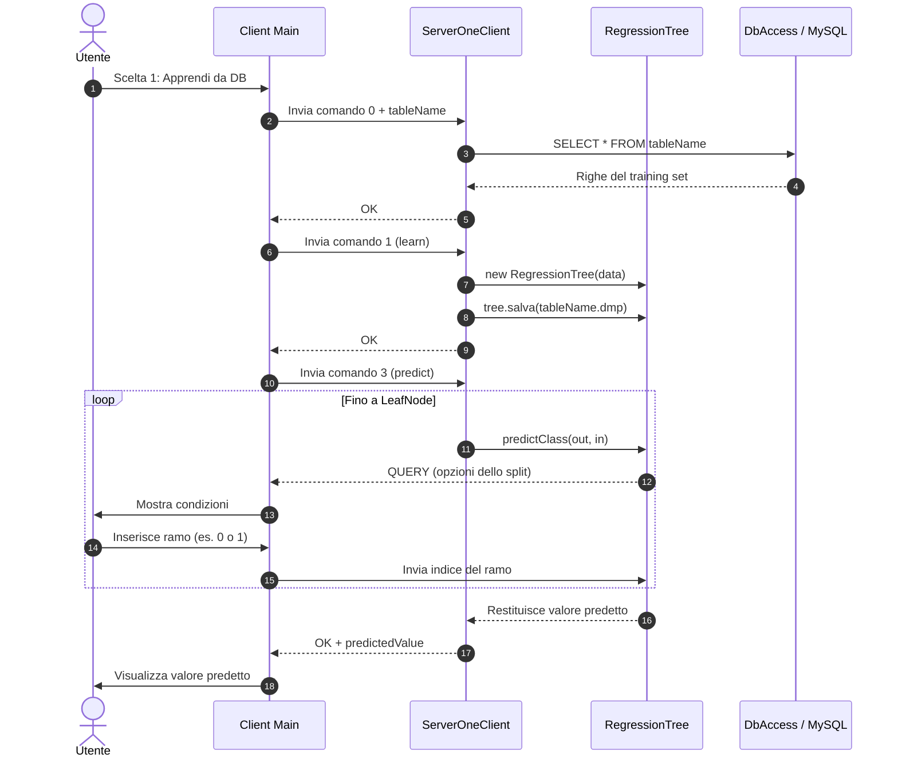

## 10. Diagramma di Sequenza UML — Protocollo REST Stateless (Spring Boot + Vaadin Flow)

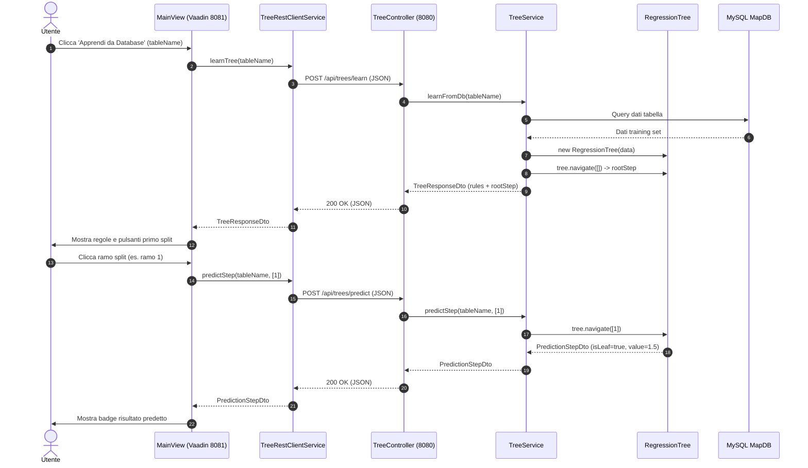

## 11. Diagramma di Deployment UML — Architettura Three-Tier

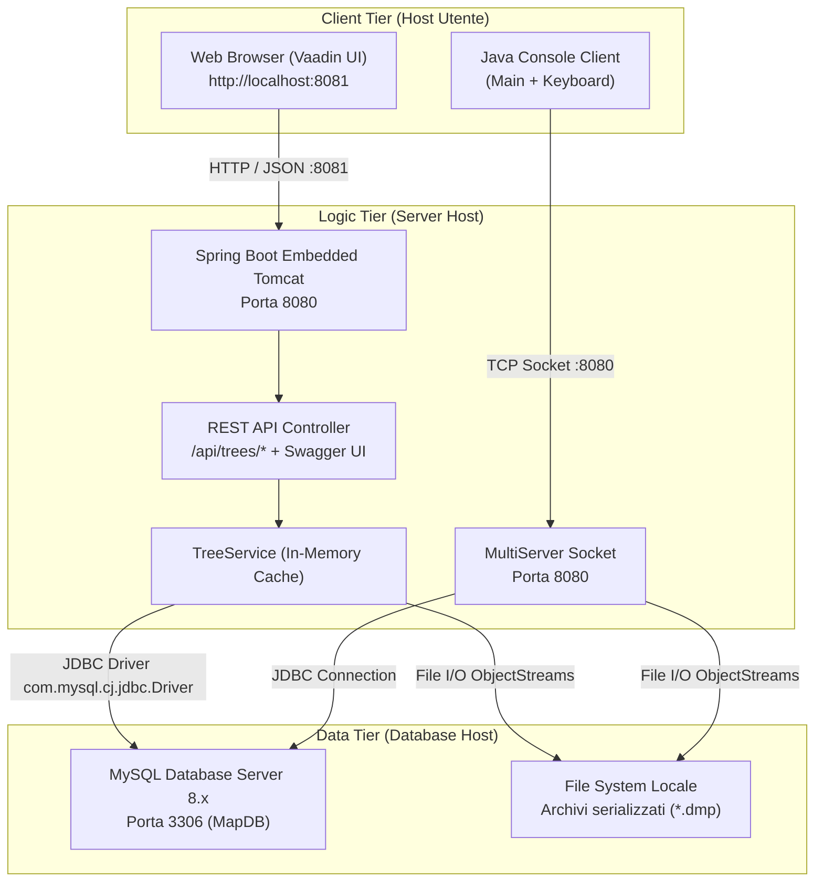
