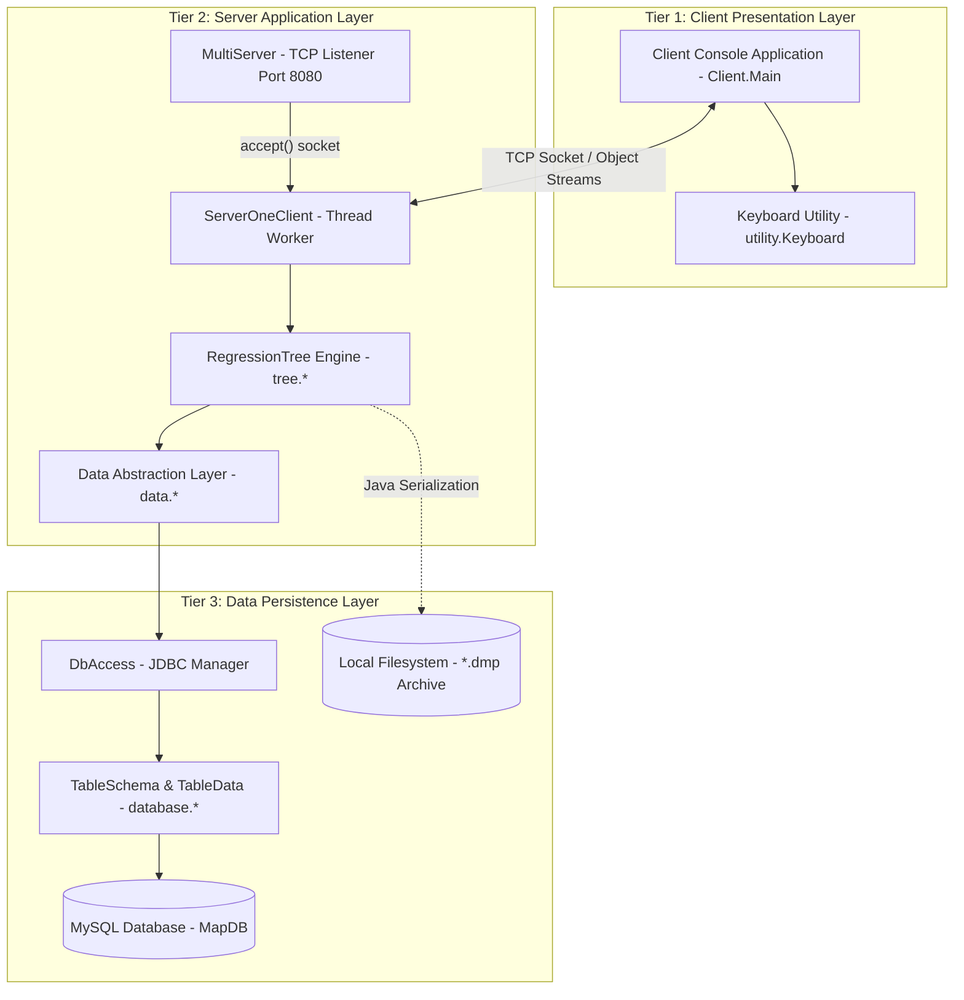
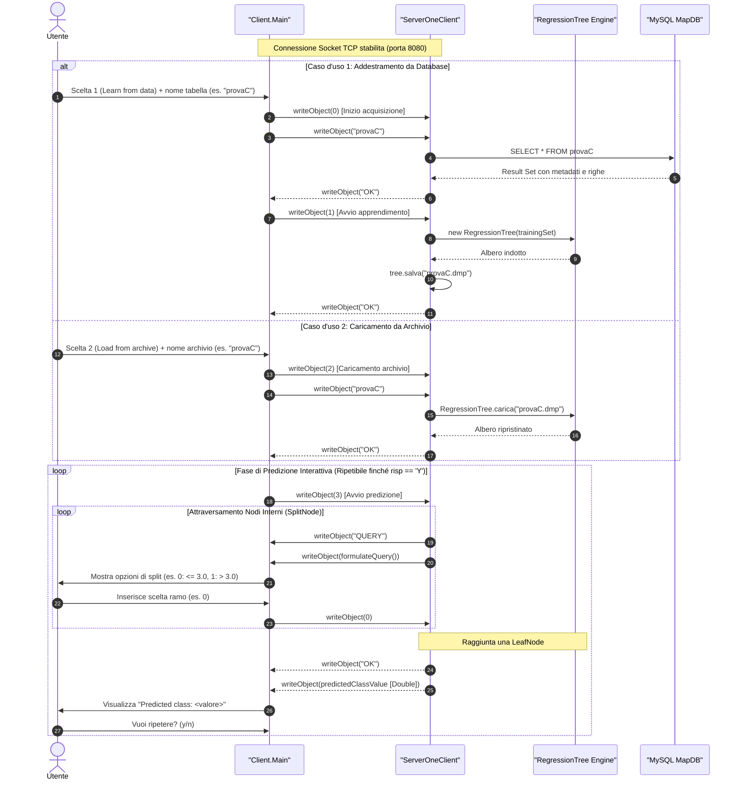
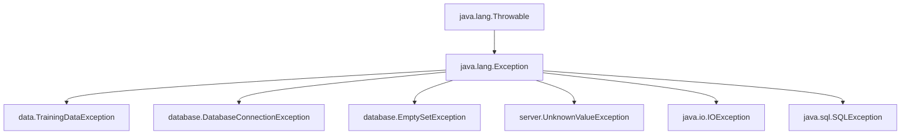
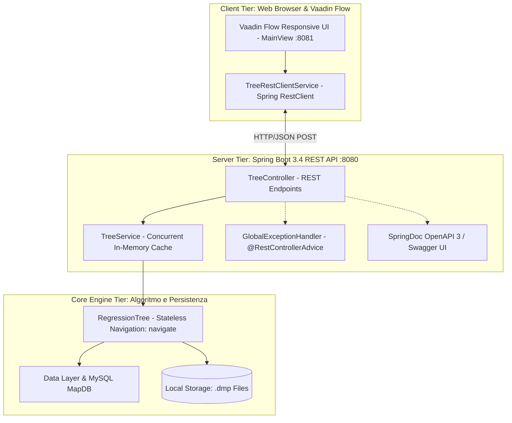

# Guida Tecnica Completa — Albero di Regressione

**Progetto:** Albero di Regressione (Sistemi di Regressione Basati su Alberi di Decisione in Java)  
**Versione:** 1.0  
**Autore:** Marco Diana  
**Target:** Sviluppatori, Ingegneri del Software, Auditor Tecnici e Valutatori Accademici  

---

## 1. Visione d'Insieme e Architettura del Sistema

Il sistema realizza un motore completo di Machine Learning supervisionato per l'apprendimento induttivo di **Alberi di Regressione** (Regression Trees) a partire da dati strutturati residenti in un database relazionale MySQL. L'albero indotto è in grado di predire il valore di una variabile target numerica continua attraverso un percorso decisionale deterministico basato su attributi esplicativi sia discreti (categorici) che continui (a valori reali).

L'architettura del software adotta il classico modello a tre livelli (**Three-Tier Architecture**), garantendo un disaccoppiamento netto delle responsabilità:



### 1.1 Separazione delle Responsabilità (Separation of Concerns)

1. **Livello di Presentazione (Client Tier):**
   - Interfaccia da terminale/riga di comando (CLI) implementata in `Client.Main`.
   - Non possiede alcuna logica di calcolo matematico o di accesso ai dati; interagisce con l'utente raccogliendo le scelte e visualizzando le regole e le predizioni restituite dal server.
   - Astrazione dell'input da console mediante la classe ausiliaria `utility.Keyboard`.
2. **Livello Applicativo e Algoritmico (Server Tier):**
   - Demone multithread `server.MultiServer` in ascolto su porta configurabile (default `8080`).
   - Gestione delle sessioni client concorrenti tramite worker thread `server.ServerOneClient`, isolando il contesto di lavoro di ciascuna connessione.
   - Motore di apprendimento induttivo ricorsivo e formulazione delle predizioni incapsulato nel package `tree` (`RegressionTree`, `Node`, `SplitNode`, `LeafNode`, `DiscreteNode`, `ContinuousNode`).
   - Astrazione del dataset in memoria mediante il package `data` (`Data`, `Attribute`, `DiscreteAttribute`, `ContinuousAttribute`).
3. **Livello Dati e Persistenza (Data Tier):**
   - Connessione JDBC al database relazionale MySQL gestita in modo centralizzato da `database.DbAccess` verso la base dati `MapDB`.
   - Introspezione dinamica dello schema relazionale tramite `database.TableSchema` e lettura delle transazioni tramite `database.TableData`.
   - Persistenza serializzata dello stato dell'albero su file binari con estensione `.dmp` tramite i meccanismi nativi di Java Object Serialization (`ObjectOutputStream` e `ObjectInputStream`).

### 1.2 Modularità Maven

Il progetto è strutturato secondo le best practice di Apache Maven con configurazione multi-modulo gerarchica:
- **`pom.xml` (Root Aggregator):** definisce la versione target di Java (Java 21 LTS — bytecode release target 21), le proprietà di codifica sorgente UTF-8 e la configurazione centralizzata di `maven-javadoc-plugin` (versione 3.11.2) con visibilità `private` e doclint disabilitato per produrre la documentazione aggregata dell'intero sistema.
- **`Server/pom.xml`:** modulo contenente il motore matematico, il server socket multithread, il package di connessione al database MySQL (dipendenza `com.mysql:mysql-connector-j:8.4.0`) e la gestione delle eccezioni.
- **`Client/pom.xml`:** modulo standalone contenente l'interfaccia a riga di comando per la connessione remota e le utilità di acquisizione da tastiera.

---

## 2. Modello Matematico e Algoritmico dell'Albero di Regressione

Un albero di regressione è un modello non parametrico che mappa uno spazio di input $\mathcal{X} = \mathcal{X}_1 \times \mathcal{X}_2 \times \dots \times \mathcal{X}_m$ in uno spazio di output continuo $\mathcal{Y} \subseteq \mathbb{R}$. Il dataset di addestramento è costituito da $n$ esempi:
$$D = \{ (\mathbf{x}_i, y_i) \}_{i=1}^n \quad \text{dove } \mathbf{x}_i = (x_{i1}, x_{i2}, \dots, x_{im}) \in \mathcal{X}, \; y_i \in \mathbb{R}$$

### 2.1 Misura di Eterogeneità: Somma dei Quadrati degli Errori ($SSE$)

Per valutare la dispersione dei valori della variabile target $y$ all'interno di un generico sottoinsieme di esempi $S \subseteq D$ di cardinalità $|S|$, il modello adotta come misura di impurità la **Somma dei Quadrati degli Errori** ($SSE$, Sum of Squared Errors):

$$SSE(S) = \sum_{i \in S} (y_i - \bar{y}_S)^2$$

dove $\bar{y}_S$ rappresenta la media aritmetica dei valori target degli esempi appartenenti a $S$:

$$\bar{y}_S = \frac{1}{|S|} \sum_{i \in S} y_i$$

#### Formulazione a Singola Passata (One-Pass Computation)
Sviluppando algebricamente il quadrato del binomio si ottiene la forma computazionalmente efficiente impiegata nel codice:

$$SSE(S) = \sum_{i \in S} \left( y_i^2 - 2 y_i \bar{y}_S + \bar{y}_S^2 \right) = \sum_{i \in S} y_i^2 - 2 \bar{y}_S \sum_{i \in S} y_i + |S| \bar{y}_S^2$$

Poiché $\sum_{i \in S} y_i = |S| \bar{y}_S$, sostituendo si ottiene:

$$SSE(S) = \sum_{i \in S} y_i^2 - 2 |S| \bar{y}_S^2 + |S| \bar{y}_S^2 = \sum_{i \in S} y_i^2 - |S| \bar{y}_S^2 = \sum_{i \in S} y_i^2 - \frac{\left( \sum_{i \in S} y_i \right)^2}{|S|}$$

Nel costruttore della classe astratta `tree.Node`, tale calcolo viene eseguito con complessità temporale strettamente lineare $O(|S|)$ e complessità spaziale ausiliaria $O(1)$:

```java
int n = endExampleIndex - beginExampleIndex + 1;
double sum = 0;
double sumSq = 0;
for (int i = beginExampleIndex; i <= endExampleIndex; i++) {
    double yi = trainingSet.getClassValue(i);
    sum += yi;
    sumSq += yi * yi;
}
variance = sumSq - (sum * sum) / n;
```

Questa formulazione evita di dover scandire due volte l'array di esempi (prima per determinare $\bar{y}_S$ e poi per accumulare gli scarti quadratici), massimizzando il throughput della CPU e minimizzando i cache miss.

### 2.2 Valore Predetto nei Nodi Foglia

Quando un nodo viene identificato come terminale (`tree.LeafNode`), esso non genera ulteriori ramificazioni. Il valore continuo predetto $\hat{y}$ assegnato alla foglia corrisponde esattamente alla media campionaria $\bar{y}_S$:

$$\hat{y} = \arg\min_c \sum_{i \in S} (y_i - c)^2 = \bar{y}_S$$

Ciò garantisce che, sul sottoinsieme $S$, l'errore quadratico medio ($MSE = \frac{SSE}{|S|}$) sia rigorosamente minimo.

### 2.3 Criterio di Partizionamento Ottimo (Split Criterion)

Dato un nodo non foglia associato al sottoinsieme $S$, l'algoritmo valuta per ciascun attributo esplicativo $A \in \{A_1, \dots, A_m\}$ la partizione generata $\mathcal{P}_A = \{S_1, S_2, \dots, S_k\}$ con $\bigcup_{j=1}^k S_j = S$ e $S_j \cap S_h = \emptyset$ per $j \neq h$.

La **varianza aggregata residua dello split** (memorizzata in `SplitNode.splitVariance`) è definita come la somma delle SSE di tutti i nodi figli:

$$V(\mathcal{P}_A) = \sum_{j=1}^k SSE(S_j)$$

La **riduzione di varianza** (Variance Gain) corrisponde a:

$$\Delta SSE(S, A) = SSE(S) - V(\mathcal{P}_A)$$

Poiché per un dato nodo $S$ il valore iniziale $SSE(S)$ è costante, massimizzare il guadagno di varianza $\Delta SSE(S, A)$ equivale esattamente a **minimizzare la varianza aggregata residua** $V(\mathcal{P}_A)$. L'attributo vincente $A^*$ soddisfa:

$$A^* = \arg\min_{A} V(\mathcal{P}_A)$$

Nel metodo `RegressionTree.determineBestSplitNode`, tutti i nodi di split candidati vengono istanziati e inseriti in una collezione `java.util.TreeSet<SplitNode>`. Poiché `SplitNode` implementa l'interfaccia `Comparable<SplitNode>` basando il confronto sul valore `splitVariance`:

```java
@Override
public int compareTo(SplitNode o) {
    if (splitVariance < o.splitVariance)
        return -1;
    if (splitVariance > o.splitVariance)
        return 1;
    return 0;
}
```

il miglior nodo di split viene estratto in tempo $O(1)$ invocando semplicemente `ts.first()`.

### 2.4 Partizionamento per Attributi Discreti (`tree.DiscreteNode`)

Per un attributo categorico $A$, il dominio ammissibile è composto da valori discreti distinti $\{v_1, v_2, \dots, v_k\}$.
1. L'algoritmo ordina preliminarmente il sottoinsieme di esempi in base ai valori dell'attributo $A$ tramite quicksort in-place.
2. In seguito all'ordinamento, tutti gli esempi che condividono il medesimo valore discreto risultano **strettamente contigui** nell'intervallo di indici $[beginExampleIndex, endExampleIndex]$.
3. Il metodo `DiscreteNode.setSplitInfo` esegue una singola scansione lineare del sottoinsieme. Non appena rileva una variazione di valore tra la riga $i-1$ e la riga $i$, chiude la partizione corrente e ne apre una successiva, memorizzando per ciascuna:
   - il valore discriminante $v_j$;
   - gli indici di inizio e fine del blocco $[beginIndex, endIndex]$;
   - l'operatore di confronto (sempre `"="`);
   - l'indice progressivo del figlio associato.

### 2.5 Partizionamento per Attributi Continui (`tree.ContinuousNode`)

Per un attributo continuo a valori reali $C$, una partizione multi-ramo comporterebbe un partizionamento eccessivo (overfitting) o degenere. Pertanto, `ContinuousNode` genera uno **split binario ottimo**:
- Ramo sinistro ($child = 0$): test $C \le \tau$
- Ramo destro ($child = 1$): test $C > \tau$

La determinazione della soglia ottima $\tau$ procede secondo la seguente strategia:
1. Gli esempi nel range $[beginExampleIndex, endExampleIndex]$ vengono ordinati in ordine crescente rispetto all'attributo $C$.
2. Le soglie candidate ottime non sono infinite, ma corrispondono ai soli punti di discontinuità in cui il valore continuo cambia tra due esempi consecutivi ordinati ($val_i \neq val_{i-1}$).
3. Per ogni punto di taglio candidato $cut = i$, si valuta la varianza ipotetica dei due rami istanziando due oggetti `LeafNode` temporanei:
   $$V_{cand}(i) = SSE([begin, i-1]) + SSE([i, end])$$
4. Viene selezionato il punto di taglio $i^*$ che minimizza $V_{cand}(i)$, impostando $\tau = val_{i^*-1}$.
5. **Caso limite (Degenerazione):** Se tutti gli esempi nell'intervallo presentano lo stesso identico valore per l'attributo continuo, non esiste alcun taglio valido ($bestCut < 0$). In questo caso viene generato un unico ramo coprente l'intero intervallo con operatore `"<="`, portando l'albero a terminare l'espansione e trasformare il nodo in foglia.

### 2.6 Ordinamento In-Place con Quicksort e Limite di Ricorsione

L'ordinamento efficiente degli esempi nel dataset di addestramento è il cardine prestazionale dell'induzione. La classe `data.Data` implementa un algoritmo **Quicksort in-place** con partizionamento di Hoare e selezione del pivot sull'elemento mediano:
$$med = \left\lfloor \frac{inf + sup}{2} \right\rfloor$$

#### Partizionamento Polimorfico (RTTI)
In base al tipo a tempo di esecuzione dell'attributo esplicativo, viene invocato il partizionatore specializzato:
- `partition(DiscreteAttribute attribute, int inf, int sup)`: opera su `String` mediante confronto lessicografico `compareTo`.
- `partition(ContinuousAttribute attribute, int inf, int sup)`: opera su `Double` mediante confronto numerico naturale.

#### Minimizzazione dello Spazio di Stack
Per prevenire rischi di overflow dello stack di chiamata Java (`StackOverflowError`) su dataset di grandi dimensioni o parzialmente ordinati, l'algoritmo adotta la tecnica fondamentale di **ricorsione obbligatoria prima sulla partizione più piccola**:

```java
if ((pos - inf) < (sup - pos + 1)) {
    quicksort(attribute, inf, pos - 1);
    quicksort(attribute, pos + 1, sup);
} else {
    quicksort(attribute, pos + 1, sup);
    quicksort(attribute, inf, pos - 1);
}
```

Questa proprietà garantisce formalmente che la profondità massima dello stack di ricorsione non superi mai $O(\log_2 |S|)$ frame di attivazione, preservando la stabilità della memoria dell'applicazione anche nel caso peggiore in cui l'albero degeneri.

### 2.7 Condizioni di Arresto dell'Induzione (`isLeaf`)

L'espansione ricorsiva di un nodo in sotto-alberi nel metodo `learnTree` si arresta, generando un `LeafNode`, al verificarsi di almeno una delle seguenti condizioni:
1. **Condizione di Cardinalità Minima (Stopping Rule predefinita):**
   $$|S| = (end - begin + 1) \le \text{numberOfExamplesPerLeaf}$$
   Nel costruttore principale di `RegressionTree`, la soglia è fissata al **10%** della cardinalità totale del dataset:
   $$\text{numberOfExamplesPerLeaf} = \left\lfloor \frac{n \cdot 10}{100} \right\rfloor$$
2. **Condizione di Assenza di Split Utili:**
   Se il miglior nodo di split individuato genera un numero di figli $\le 1$ (`root.getNumberOfChildren() <= 1`), significa che tutti gli esempi nel sottoinsieme presentano valori costanti su tutti gli attributi esplicativi. Non è possibile alcuna ulteriore discriminazione informativa.
3. **Purezza del Sottoinsieme:**
   Se la varianza $SSE(S) = 0$, tutti gli esempi possiedono il medesimo valore target; qualsiasi split ulteriore risulterebbe ridondante.

---

## 3. Analisi Dettagliata dei Moduli e delle Classi

### 3.1 Package `data`

| Classe / Interfaccia | Ruolo e Responsabilità | Dettagli Implementativi |
|---|---|---|
| `Attribute` *(abstract)* | Modella il concetto generale di attributo esplicativo. | Implementa `Serializable`. Incapsula `name` (String) e `index` (int posizionale). |
| `DiscreteAttribute` | Specializzazione per attributi categorici con dominio finito. | Estende `Attribute`, implementa `Iterable<String>`. Mantiene i valori univoci in un `TreeSet<String>` ordinato. |
| `ContinuousAttribute` | Specializzazione per attributi numerici a valori continui reali. | Estende `Attribute`. Utilizzato sia per l'attributo di classe (target) sia per predittori numerici. |
| `Data` | Tabella di addestramento in memoria centrale. | Contiene `List<Example> data`, `List<Attribute> explanatorySet` e `ContinuousAttribute classAttribute`. Implementa quicksort e gestione metadati SQL. |
| `TrainingDataException` | Eccezione controllata per anomalie di addestramento. | Sollevata in caso di tabelle vuote, meno di 2 colonne, colonna target non numerica o valori nulli. |

### 3.2 Package `database`

| Classe / Interfaccia | Ruolo e Responsabilità | Dettagli Implementativi |
|---|---|---|
| `DbAccess` | Gestore del ciclo di vita della connessione JDBC MySQL. | Carica il driver `com.mysql.cj.jdbc.Driver`, si connette a `localhost:3306/MapDB` con credenziali `MapUser`/`map`. |
| `TableSchema` | Introspezione e mappatura dello schema relazionale. | Utilizza `DatabaseMetaData.getColumns` per mappare i tipi SQL in categorie `"string"` o `"number"`. |
| `TableData` | Esecuzione di query per estrazione di dati e tuple. | Fornisce i metodi `getTransazioni(table)` e `getDistinctColumnValues(table, column)`. |
| `Column` | Descrittore di colonna relazionale (nome e tipo logico). | Metodi `getColumnName()`, `isNumber()`, `toString()`. |
| `Example` | Modella una singola tupla del dataset relazionale. | Implementa `Comparable<Example>` e `Iterable<Object>`. Contiene `List<Object> example`. |
| `DatabaseConnectionException` | Eccezione per errori di connessione JDBC o driver assente. | Sottoclasse controllata di `Exception`. |
| `EmptySetException` | Eccezione per query SQL che restituiscono zero tuple. | Segnala l'assenza di dati per l'addestramento. |

### 3.3 Package `tree`

| Classe / Interfaccia | Ruolo e Responsabilità | Dettagli Implementativi |
|---|---|---|
| `RegressionTree` | Modello globale dell'albero indotto e motore di predizione. | Implementa `Serializable`. Coordina l'induzione ricorsiva, la formattazione delle regole (`printRules`), la navigazione socket e la serializzazione (`salva`/`carica`). |
| `Node` *(abstract, package-private)* | Radice gerarchica per i nodi dell'albero. | Implementa `Serializable`. Calcola `variance` ($SSE$) a singola passata, gestisce `idNode` statico incrementale e range indici `[begin, end]`. |
| `LeafNode` *(package-private)* | Nodo terminale foglia dell'albero. | Estende `Node`. Calcola la media dei valori di classe $\bar{y}_S$ (`predictedClassValue`). `getNumberOfChildren()` restituisce 0. |
| `SplitNode` *(abstract, package-private)* | Nodo interno di diramazione. | Estende `Node`, implementa `Comparable<SplitNode>`. Mantiene `Attribute attribute`, `List<SplitInfo> mapSplit` e `splitVariance`. Definisce la inner class `SplitInfo`. |
| `SplitInfo` *(package-private inner class)* | Dettaglio descrittivo di un ramo di partizione. | Implementa `Serializable`. Incapsula `splitValue`, `beginIndex`, `endIndex`, `numberChild` e `comparator` (`"="`, `"<="`, `">"`). |
| `DiscreteNode` *(package-private)* | Nodo di split per attributi discreti. | Estende `SplitNode`. Genera tanti rami quanti sono i valori distinti contigui; `testCondition` effettua uguaglianza diretta su `Object`. |
| `ContinuousNode` *(package-private)* | Nodo di split binario per attributi continui. | Estende `SplitNode`. Cerca la soglia di taglio ottima minimizzando la somma degli SSE delle due partizioni; `testCondition` valuta `<=` e `>`. |

### 3.4 Package `server` e `Client`

| Classe | Ruolo e Responsabilità | Dettagli Implementativi |
|---|---|---|
| `MultiServer` | Demone multithread di ascolto connessioni TCP. | Crea `ServerSocket` su porta specificata (default `8080`) e lancia un'istanza di `ServerOneClient` per ogni `accept()`. |
| `ServerOneClient` | Worker thread per la gestione del singolo client. | Estende `Thread`. Inizializza `ObjectOutputStream` e `ObjectInputStream`, gestisce il dispatcher a stati su switch-case (codici `0`, `1`, `2`, `3`). |
| `UnknownValueException` | Eccezione di validazione input nella predizione. | Sollevata se l'utente seleziona un indice di ramo fuori range o non conforme. |
| `Client.Main` | Applicazione client a riga di comando. | Si connette via socket, interagisce con l'utente da console, coordina i comandi verso il server e visualizza le predizioni. |
| `utility.Keyboard` | Gestore robusto dell'input standard (System.in). | Parsing tipizzato (`readInt`, `readDouble`, `readString`, `readChar`), tokenizzazione e gestione integrata degli errori. |

---

## 4. Protocollo di Comunicazione Client-Server e Serializzazione Binaria

La comunicazione tra il client CLI e il thread worker `ServerOneClient` avviene su socket TCP/IP tramite flussi a oggetti Java:
- `java.io.ObjectOutputStream`: serializza tipi primitivi, comandi e messaggi applicativi.
- `java.io.ObjectInputStream`: deserializza gli oggetti ricevuti preservando la tipizzazione forte.

### 4.1 Macchina a Stati del Protocollo

Il protocollo è strutturato attorno a quattro codici di comando numerici inviati dal Client:



### 4.2 Dettaglio dei Comandi del Protocollo

1. **Comando `0` (Acquisizione Dati):**
   - **Client invia:** `(Integer) 0`, seguito da `(String) tableName`.
   - **Server esegue:** Istanzia `data.Data(tableName)`, verificando la connessione JDBC, lo schema, le colonne e le tuple.
   - **Server risponde:** `"OK"` se l'operazione ha successo; in caso di errore restituisce la stringa dell'eccezione `TrainingDataException`.
2. **Comando `1` (Apprendimento e Salvataggio Automatico):**
   - **Client invia:** `(Integer) 1`.
   - **Server esegue:** Istanzia `tree.RegressionTree(trainingSet)` avviando l'induzione ricorsiva; al termine invoca automaticamente `tree.salva(tableName + ".dmp")`.
   - **Server risponde:** `"OK"` se l'albero è stato appreso e serializzato su disco; stringa dell'eccezione `IOException` altrimenti.
3. **Comando `2` (Caricamento da Archivio `.dmp`):**
   - **Client invia:** `(Integer) 2`, seguito da `(String) tableName`.
   - **Server esegue:** Normalizza il percorso assicurando l'estensione `.dmp` e invoca `RegressionTree.carica(archiveName)`.
   - **Server risponde:** `"OK"` se il file è valido e deserializzato correttamente; stringa dell'eccezione (`FileNotFoundException`, `ClassNotFoundException` o `IOException`) altrimenti.
4. **Comando `3` (Predizione Interattiva):**
   - **Client invia:** `(Integer) 3`.
   - **Ciclo di query:** Finché il percorso attraversa nodi di split (`SplitNode`), il server trasmette la stringa `"QUERY"` e la formulazione del bivio generata da `SplitNode.formulateQuery()`.
   - **Validazione:** Il server legge la scelta del client (intero base 0). Se l'indice è $< 0$ o $\ge \text{numberOfChildren}$, il server solleva `UnknownValueException` e interrompe il ciclo.
   - **Terminazione:** All'arrivo su un `LeafNode`, il server invia `"OK"` seguito dall'oggetto `Double` contenente il valore predetto.

### 4.3 Serializzazione Binaria (`.dmp`)

Tutte le classi che compongono la struttura ad albero (`RegressionTree`, `Node`, `LeafNode`, `SplitNode`, `ContinuousNode`, `DiscreteNode`, `SplitInfo`, `Attribute`, `DiscreteAttribute`, `ContinuousAttribute`) implementano l'interfaccia `java.io.Serializable` con campo esplicito `private static final long serialVersionUID = 1L;`.

Vantaggi del meccanismo:
- **Persistenza Completa del Grafo degli Oggetti:** La serializzazione preserva l'intera gerarchia dell'albero indotto, inclusi tutti i rami, le soglie ottime, le etichette degli attributi e i valori continui calcolati.
- **Riuso Immediato:** Evita di dover ripetere l'addestramento su database MySQL (operazione computazionalmente onerosa su dataset estesi), consentendo l'avvio immediato delle predizioni da file binario in tempo $O(1)$.
- **Integrità Versione:** `serialVersionUID` previene inconsistenze di deserializzazione in caso di evoluzioni binarie incompatibili della classe.

---

## 5. Gestione delle Eccezioni e Robustezza

Il sistema adotta un modello di gestione degli errori rigoroso e controllato, incapsulando tutte le condizioni anomale in eccezioni checked che proteggono l'integrità del processo server e guidano l'utente verso il recupero dell'errore.



### 5.1 Tassonomia delle Eccezioni

1. **`data.TrainingDataException`:**
   - *Origine:* Violazioni dell'integrità dei dati nella tabella MySQL.
   - *Cause scatenanti:* Nome tabella nullo o vuoto; tabella inesistente; numero di colonne $< 2$; ultima colonna non numerica (impossibile fare regressione su target non continuo); presenza di valori `NULL` nelle colonne; tabella completamente priva di tuple.
   - *Strategia:* Incapsula la causa originale (`Throwable cause`) conservando lo stack trace per il debug e invia una spiegazione testuale leggibile al client.
2. **`database.DatabaseConnectionException`:**
   - *Origine:* Fallimento della comunicazione con il server MySQL.
   - *Cause scatenanti:* MySQL Server non in esecuzione su `localhost:3306`; credenziali errate (`MapUser`/`map`); database `MapDB` inesistente; driver JDBC `com.mysql.cj.jdbc.Driver` assente dal classpath.
3. **`database.EmptySetException`:**
   - *Origine:* Query di selezione dati a vuoto.
   - *Cause scatenanti:* La tabella indicata esiste a livello di schema ma contiene zero righe (`COUNT(*) == 0`).
4. **`server.UnknownValueException`:**
   - *Origine:* Input client non valido durante la discesa dell'albero.
   - *Cause scatenanti:* L'utente seleziona un indice di ramo negativo o maggiore/uguale al numero di partizioni disponibili per il nodo di split corrente.

### 5.2 Strategie di Gestione delle Risorse

- **Chiusura Deterministica (Try-With-Resources):** Le connessioni JDBC, gli `Statement`, i `ResultSet` e gli stream di file/socket sono gestiti tramite blocchi `try-with-resources` o clausole `finally` di pulizia esplicita, prevenendo memory leak, connection leak verso MySQL o file-handle rimasti aperti.
- **Isolamento dei Thread Client:** Ogni eccezione di I/O o disconnessione anomala del client causata dalla chiusura improvvisa della finestra terminale viene intercettata nel blocco `catch (IOException | ClassNotFoundException e)` del singolo `ServerOneClient`, provocando la chiusura ordinata del rispettivo socket senza impattare né il server principale `MultiServer` né gli altri client connessi concorrentemente.

---

## 6. Architettura dell'Estensione Web: Backend Spring Boot REST, Contratti DTO, Navigazione Stateless, OpenAPI / Swagger e Frontend Vaadin Flow

In aggiunta all'infrastruttura socket TCP nativa, il sistema include un'estensione architetturale completa basata su standard Web moderni, realizzando la transizione da un protocollo di connessione point-to-point stateful a un'architettura distribuita **stateless HTTP/REST** con interfaccia grafica reattiva web.



### 6.1 Motivazione e Paradigma Stateless
Il protocollo socket classico vincola il client a una connessione TCP persistente e bidirezionale in cui il server memorizza nello stack di chiamata del thread `ServerOneClient` la posizione corrente durante la discesa ricorsiva dell'albero. Se la connessione cade, la sessione viene persa.
L'estensione Web introduce il paradigma **stateless**: ogni richiesta HTTP inviata al server contiene l'intero contesto necessario per individuare il sotto-nodo desiderato, consentendo scalabilità orizzontale, riuso tra più utenti concorrenti e tolleranza alle disconnessioni.

### 6.2 Contratti DTO Immutabili (Package `dto`)
La comunicazione tra client e server avviene tramite contratti JSON modellati come **Java Records** immutabili nel package `dto` (condiviso semanticamente tra Server e Client):
1. **`TreeRequestDto(String tableName)`:** incapsula il nome della tabella del database o dell'archivio da elaborare.
2. **`PredictionStepDto(boolean isLeaf, Double predictedValue, String attributeName, List<String> branchOptions)`:** descrive lo stato del nodo raggiunto nell'albero. Se `isLeaf == true`, contiene il valore numerico stimato `predictedValue` ed esclude opzioni di scelta; se `isLeaf == false`, specifica l'attributo di split (`attributeName`) e l'elenco delle condizioni dei rami figli (`branchOptions`).
3. **`TreeResponseDto(String tableName, String treeRules, PredictionStepDto rootStep)`:** restituito dopo l'apprendimento o il caricamento, contiene il nome della tabella, la trascrizione completa dell'albero e delle regole IF-THEN (`treeRules`), e il DTO descrittivo della radice (`rootStep`).
4. **`PredictRequestDto(String tableName, List<Integer> path)`:** invia al server il nome del modello e la sequenza 0-based di indici di ramo percorsi (`path`), richiedendo la valutazione stateless del nodo corrispondente.

I Record garantiscono costruttori canonici, metodi di accesso uniformi, implementazione corretta di `equals()`, `hashCode()`, `toString()` e serializzabilità Jackson automatica senza overhead o stato mutabile.

### 6.3 Navigazione Stateless Ricorsiva in `RegressionTree`
Per supportare il paradigma stateless senza alterare il funzionamento del socket, la classe `tree.RegressionTree` è stata arricchita con due metodi chiave con retrocompatibilità totale:
- **`public PredictionStepDto navigate(List<Integer> path) throws UnknownValueException`:** a partire dalla radice dell'albero, itera sequenzialmente lungo gli indici specificati in `path`. Se l'indice è valido e il nodo corrente è uno `SplitNode`, discende nel sotto-albero `childTree[branchIndex]`. Se il percorso conduce a un `LeafNode`, restituisce un `PredictionStepDto` foglia; altrimenti restituisce il bivio decisionale corrente con le condizioni di split formulate dinamicamente.
- **`public String getRules()`:** metodo thread-safe che genera la stringa completa dell'albero e delle regole IF-THEN senza richiedere flussi di output standard.

### 6.4 Backend Spring Boot REST API
Il backend è ospitato nel modulo `Server` su porta `8080`:
- **`server.ServerApplication`:** classe di avvio annotata con `@SpringBootApplication` e `@Import({TreeService.class, TreeController.class, GlobalExceptionHandler.class})`.
- **`server.TreeService`:** servizio applicativo `@Service` dotato di una cache concorrente in memoria `ConcurrentHashMap<String, RegressionTree>`. Se un albero non è in cache al momento della predizione, viene automaticamente ripristinato dal file binario `.dmp` su disco.
- **`server.TreeController`:** controller `@RestController` su base path `/api/trees`:
  - `POST /api/trees/learn`: addestra l'albero da tabella MySQL, salva il `.dmp`, memorizza in cache e restituisce `TreeResponseDto`.
  - `POST /api/trees/load`: deserializza il `.dmp` da disco, memorizza in cache e restituisce `TreeResponseDto`.
  - `POST /api/trees/predict`: esegue la navigazione stateless lungo `path` e restituisce `PredictionStepDto`.
- **`server.GlobalExceptionHandler`:** gestore centralizzato `@RestControllerAdvice` che converte le eccezioni in risposte HTTP semantiche con payload `{"error": "..."}`:
  - `404 Not Found` per `FileNotFoundException` (file `.dmp` inesistente).
  - `400 Bad Request` per `TrainingDataException`, `UnknownValueException`, `IllegalArgumentException`, `IOException`.
  - `500 Internal Server Error` per eccezioni impreviste.

### 6.5 Documentazione OpenAPI 3 e Swagger UI
L'integrazione della dipendenza `org.springdoc:springdoc-openapi-starter-webmvc-ui:2.8.5` espone:
- Specifiche OpenAPI 3 formali in formato JSON all'endpoint `/v3/api-docs`.
- Interfaccia grafica interattiva all'endpoint `http://localhost:8080/swagger-ui.html` (reindirizzata a `/swagger-ui/index.html`), consentendo a sviluppatori e collaudatori di testare in tempo reale le richieste REST con validazione degli schemi e visualizzazione immediata delle risposte HTTP.

### 6.6 Frontend Web Vaadin Flow (Porta 8081)
Il modulo `Client` include un frontend web moderno in puro Java con **Vaadin Flow 24.6.4**:
- **`Client.ClientApplication`:** entrypoint Spring Boot che avvia il server web embedded su porta `8081`.
- **`Client.TreeRestClientService`:** client HTTP dichiarativo basato su Spring `RestClient` (`@Service`) che comunica con il backend su `http://localhost:8080`.
- **`Client.MainView`:** interfaccia utente responsive (`@Route("")`) organizzata con layout ergonomico:
  - Form di configurazione per selezionare la modalità (Database MySQL o File `.dmp`) e inserire il nome della tabella (es. `provaC`).
  - Pulsante di acquisizione con feedback di caricamento e gestione delle notifiche visive di errore.
  - Sezione di visualizzazione con `TextArea` a larghezza intera per consultare la struttura dell'albero e le regole decisionali IF-THEN estratte.
  - Pannello di predizione interattivo: visualizza dinamicamente l'attributo di split corrente e crea pulsanti cliccabili per ciascun ramo figlio (es. `[=A]`, `[=B]` oppure `[<=2.0]`, `[>2.0]`).
  - Al raggiungimento della foglia, presenta in evidenza con badge grafico il valore numerico continuo predetto e un pulsante per avviare una nuova predizione.


---


## 7. Qualità del Software, Incapsulamento OOP e Documentazione Javadoc


Il progetto adotta standard rigorosi di Ingegneria del Software e Programmazione Orientata agli Oggetti (OOP):


### 7.1 Incapsulamento Rigoroso e Visibilità

- **Campi Dati Privati (`private`):** Tutti gli attributi di stato di tutte le classi dell'intero codebase sono stati dichiarati `private`. L'accesso allo stato avviene esclusivamente tramite opportuni metodi getter pubblici o package-private.

- **Visibilità Protetta Mirata (`protected`):** L'unica eccezione conforme ai canoni della programmazione ad oggetti riguarda il campo `protected List<SplitInfo> mapSplit` nella classe astratta `tree.SplitNode`, necessario per consentire l'accesso diretto e polimorfico alle sottoclassi concrete `DiscreteNode` e `ContinuousNode`.

- **Costruttori Espliciti e Documentati:** Ogni classe istanziabile dichiara un costruttore esplicito con documentazione Javadoc analitica (`ServerApplication`, `ClientApplication`, `Main`, `DbAccess`, `Example`, `TreeService`, `GlobalExceptionHandler`).

- **Costruttori Privati per Classi di Utilità ed Entrypoint Statici:** Le classi che fungono da raccolta di funzioni statiche (`utility.Keyboard`) o da entrypoint (`server.Main`) dichiarano un costruttore privato esplicito per prevenire l'istanziamento improprio.

- **Serializzazione e Integrità dei Dati (`serialVersionUID`):** Tutte le entità serializzabili (`Attribute`, `ContinuousAttribute`, `DiscreteAttribute`, `Node`, `LeafNode`, `SplitNode`, `ContinuousNode`, `DiscreteNode`, `SplitNode.SplitInfo`, `RegressionTree`), le eccezioni di dominio (`TrainingDataException`, `DatabaseConnectionException`, `EmptySetException`, `UnknownValueException`) e tutti i Record DTO (`TreeRequestDto`, `TreeResponseDto`, `PredictRequestDto`, `PredictionStepDto`) dichiarano esplicitamente `private static final long serialVersionUID = 1L;`.

- **Eliminazione delle Deprecazioni:** Nella classe `utility.Keyboard`, i costruttori deprecati di `Float` e `Double` sono stati sostituiti con `Float.parseFloat()` e `Double.parseDouble()`, e il parsing booleano impiega `equalsIgnoreCase()`.


### 7.2 Documentazione di Package (`package-info.java`)

Ciascun package architetturale (`data`, `database`, `tree`, `server`, `utility`, `Client`, `dto`) include un file `package-info.java` completo che descrive formalmente:

- Il ruolo e le responsabilità del modulo nell'architettura a tre livelli e nell'estensione Web;

- Le classi e interfacce principali contenute;

- Le interazioni e i flussi informativi verso gli altri package.


### 7.3 Configurazione Javadoc Aggregato con Visibilità Private

La configurazione del plugin Maven `maven-javadoc-plugin` nel root `pom.xml` è impostata con:

- `<show>private</show>`: consente la generazione della documentazione completa che include non solo le API pubbliche, ma anche i nodi package-private dell'albero di regressione (`Node`, `SplitNode`, `LeafNode`, `DiscreteNode`, `ContinuousNode`, `SplitInfo`), i campi dati privati e i metodi ausiliari.

- Documentazione aggregata multi-modulo generabile tramite `mvn javadoc:aggregate`, consultabile direttamente a partire da `docs/javadoc/index.html`.


---


## 8. Strategia di Testing e Validazione Sperimentale


La correttezza matematica, la robustezza e la conformità architetturale del sistema sono certificate da una suite di **60 test automatizzati** eseguiti tramite JUnit 5, Mockito e Spring Boot Test:


### 8.1 Struttura della Suite di Test

1. **Modulo Client (16 test):**

   - `utility.KeyboardTest` (7 test): validazione isolata dell'acquisizione di tutti i tipi primitivi (`String`, `boolean`, `char`, `int`, `long`, `float`, `double`), gestione errori e reset buffer tramite reflection.

   - `Client.TreeRestClientServiceTest` (4 test): collaudo del client REST basato su Spring `RestClient` mediante `MockRestServiceServer`, con verifica delle chiamate POST `/learn`, `/load`, `/predict` e dell'estrazione dei messaggi d'errore JSON.
   - `Client.TreeMermaidConverterTest` (5 test): validazione del parser di regole e del generatore di grafi decisionali Mermaid vettoriali per la visualizzazione dell'albero a video.

2. **Modulo Server (44 test):**

   - `data.AttributeTest` (6 test): verifica gerarchia `Attribute`, deduplicazione in `TreeSet` per attributi discreti e serializzazione binaria.

   - `data.DataTest` (11 test): test di integrazione nominale con MySQL `MapDB.provaC`, quicksort in-place polimorfico e casi d'errore (mock di tabelle con meno di 2 colonne, target non numerico, valori nulli).

   - `database.DatabasePackageTest` (8 test): introspezione metadati JDBC, ciclo di vita della connessione `DbAccess`, estrazione transazioni `TableData` e mapping `Column`/`Example`.

   - `tree.TreeNodesAndAlgorithmTest` (10 test): verifica analitica del calcolo matematico $SSE$ a singola passata, partizionamento discreto e continuo, soglie ottime, induzione completa, serializzazione `.dmp` e predizione interattiva con flussi binari.

   - `server.SocketClientServerIntegrationTest` (3 test): test end-to-end su socket TCP reale con porta effimera per i flussi completi di addestramento, caricamento da archivio e gestione errori.

   - `server.EndToEndRestAndClientIntegrationTest` (5 test): test end-to-end su backend Spring Boot REST (`@SpringBootTest(webEnvironment = RANDOM_PORT)`), validando gli endpoint REST, la navigazione stateless lungo l'albero, la gestione errori semantica (HTTP 400/404) e la disponibilità delle specifiche OpenAPI 3 e Swagger UI.


### 8.2 Risultati del Testing

- **Test Totali Eseguiti:** 60

- **Fallimenti (Failures):** 0

- **Errori (Errors):** 0

- **Tasso di Successo:** 100%

- Per la matrice completa di tracciabilità requisiti e le schede tecniche dettagliate, consultare [docs/documentazione-test.md](documentazione-test.md).

