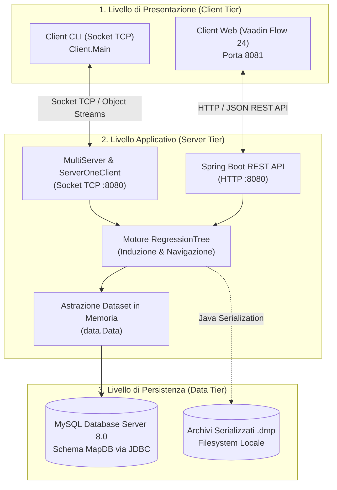
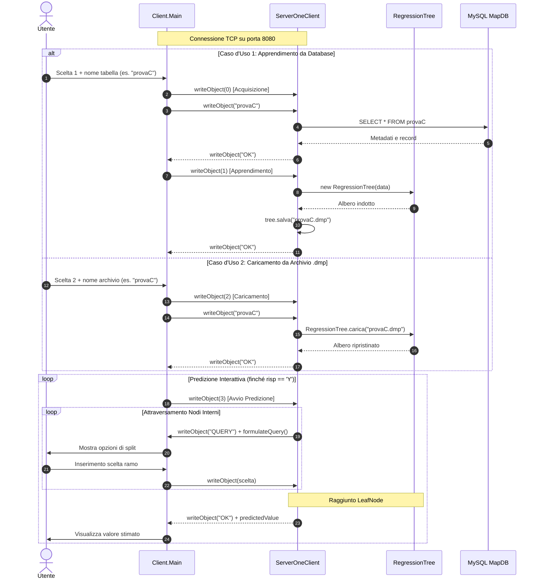
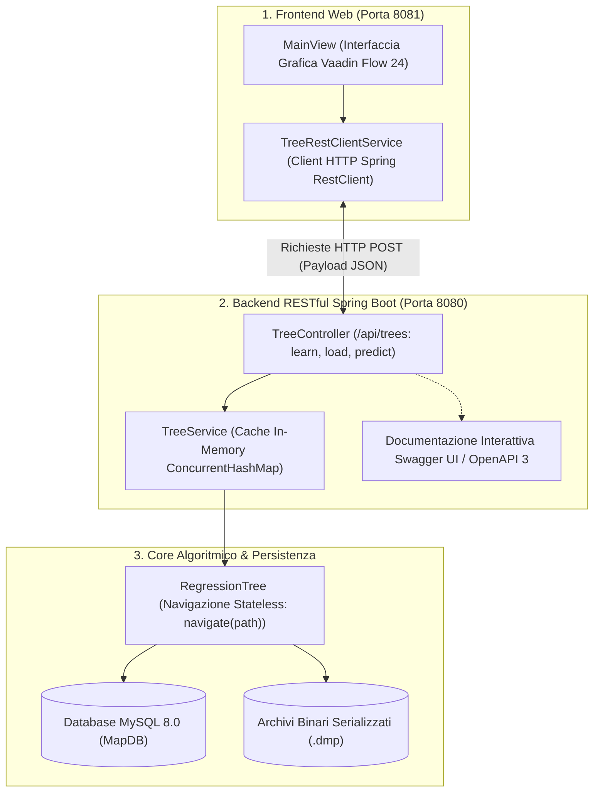

# Guida Tecnica — Albero di Regressione

## 1. Architettura del Sistema

Il sistema realizza un motore in Java per l'apprendimento induttivo di **Alberi di Regressione** (Regression Trees) a partire da dati strutturati residenti in un database relazionale MySQL. L'albero indotto predice una variabile target numerica continua attraverso un percorso decisionale deterministico basato su attributi discreti e continui.

L'architettura del software adotta un modello a tre livelli (**Three-Tier Architecture**) con supporto a una doppia interfaccia di accesso (Console TCP tradizionale ed Estensione Web moderna):

### 1.1 Moduli del Progetto e Suddivisione delle Responsabilità

Il progetto è gestito tramite Apache Maven con gerarchia multi-modulo (Java 21 LTS):

- **Root Aggregator (`pom.xml`):** centralizza le configurazioni di compilazione, encoding UTF-8, dipendenze condivise e configurazione di `maven-javadoc-plugin` con visibilità `private` per la generazione aggregata.
- **Modulo `Server`:** incapsula il core matematico di regressione (`tree`), le strutture dati del dataset (`data`), il sottosistema di accesso a MySQL (`database`), il demone multithread a socket TCP (`server`) e l'estensione RESTful con Spring Boot 3.4 (`server.TreeController`, `server.TreeService`).
- **Modulo `Client`:** comprende l'applicazione da console per socket TCP (`Client.Main`, `utility.Keyboard`) e la Web Application interattiva sviluppata con Spring Boot e Vaadin Flow 24 (`Client.MainView`, `Client.TreeRestClientService`).

---

## 2. Core Algoritmico: Albero di Regressione

Il modello apprende una funzione predittiva non parametrica che mappa uno spazio di input $\mathcal{X}$ in un target continuo $\mathcal{Y} \subseteq \mathbb{R}$ a partire da un dataset di addestramento $D = \{ (\mathbf{x}_i, y_i) \}_{i=1}^n$.

### 2.1 Criterio di Impurità e Calcolo della Varianza ($SSE$)

Per valutare la dispersione dei valori target all'interno di un generico sottoinsieme di esempi $S \subseteq D$, il modello adotta la **Somma dei Quadrati degli Errori** ($SSE$, Sum of Squared Errors):

$$SSE(S) = \sum_{i \in S} (y_i - \bar{y}_S)^2 = \sum_{i \in S} y_i^2 - \frac{\left( \sum_{i \in S} y_i \right)^2}{|S|}$$

Nel costruttore della classe base `tree.Node`, tale calcolo viene eseguito con **complessità temporale lineare $O(|S|)$ in un'unica scansione (One-Pass)**, accumulando contemporaneamente la somma dei valori e la somma dei quadrati, con complessità spaziale ausiliaria $O(1)$.

### 2.2 Nodi Terminali (Foglie)

Quando un nodo soddisfa i criteri di arresto, viene istanziato come `tree.LeafNode`. Il valore continuo predetto $\hat{y}$ corrisponde esattamente alla media campionaria della variabile target nel sottoinsieme associato:

$$\hat{y} = \bar{y}_S = \frac{1}{|S|} \sum_{i \in S} y_i$$

Questa scelta garantisce la minimizzazione formale dell'errore quadratico medio ($MSE$) sul nodo.

### 2.3 Selezione del Miglior Nodo di Split

Dato un nodo non terminale, l'algoritmo seleziona l'attributo esplicativo $A^*$ che genera la partizione $\mathcal{P}_A = \{S_1, \dots, S_k\}$ con la minima **varianza aggregata residua**:

$$A^* = \arg\min_A \sum_{j=1}^k SSE(S_j)$$

Tutti i nodi candidati di split vengono inseriti in un `TreeSet<SplitNode>`, che sfrutta l'implementazione dell'interfaccia `Comparable<SplitNode>` basata sul valore di varianza residua per estrarre il miglior candidato in tempo $O(1)$ (`TreeSet.first()`).

### 2.4 Split Polimorfici: Discreti e Continui

La diramazione dell'albero adotta strategie specializzate a seconda della natura dell'attributo:

- **Attributi Discreti (`tree.DiscreteNode`):** dopo aver ordinato gli esempi tramite quicksort sull'attributo categorico, i record aventi il medesimo valore risultano contigui. Una scansione lineare identifica i blocchi e genera tanti rami quanti sono i valori distinti (partizione multi-ramo con operatore `"="`).
- **Attributi Continui (`tree.ContinuousNode`):** genera un **bivio binario ottimo** (ramo sinistro $\le \tau$, ramo destro $> \tau$). Dopo aver ordinato gli esempi sul valore continuo, l'algoritmo valuta la varianza residua in corrispondenza di ciascun punto di transizione fra valori distinti consecutivi e seleziona la soglia di taglio $\tau$ che minimizza la somma degli $SSE$ delle due partizioni.

### 2.5 Ottimizzazione della Ricorsione e Quicksort In-Place

L'ordinamento dei dati in memoria (`data.Data`) è implementato mediante un algoritmo **Quicksort in-place** con perno sull'elemento mediano. Per prevenire qualsiasi rischio di `StackOverflowError` su dataset estesi o sbilanciati, l'algoritmo applica la regola formale della **ricorsione obbligatoria sul sottoinsieme di cardinalità minore**, garantendo che la profondità dello stack di chiamata Java non superi mai $O(\log_2 n)$.

### 2.6 Condizioni di Arresto dell'Induzione

La ricorsione nel metodo `learnTree` termina trasformando il nodo in `LeafNode` al verificarsi di almeno una delle seguenti condizioni:

- **Cardinalità Minima:** il numero di esempi del nodo è $\le$ al 10% della cardinalità totale del dataset ($\lfloor n / 10 \rfloor$).
- **Assenza di Split Informativi:** tutti gli attributi presentano valori costanti nel sottoinsieme considerato (numero di figli generati $\le 1$).
- **Purezza del Sottoinsieme:** varianza $SSE(S) = 0.0$ (tutti gli esempi condividono lo stesso valore target continuo).

---

## 3. Protocolli di Comunicazione e Flussi Operativi

Il sistema supporta due canali di interazione indipendenti e concorrenti: il canale tradizionale su Socket TCP e l'estensione stateless su API REST.

### 3.1 Canale Socket TCP Tradizionale (Stateful)

Il server avvia un listener multithread (`MultiServer`) su porta `8080`. Per ogni connessione in ingresso viene creato un thread dedicato (`ServerOneClient`), che gestisce il dialogo mediante stream di oggetti serializzati (`ObjectOutputStream` e `ObjectInputStream`).

### 3.2 Estensione Web: REST API Stateless e Frontend Vaadin Flow

L'estensione Web introduce un'architettura **stateless** basata su Spring Boot e Vaadin Flow 24, eliminando la necessità di mantenere thread o connessioni socket persistenti bloccate durante l'interazione con l'utente:

- **Contratti DTO Immutabili (`dto`):** scambiati in formato JSON tramite Java Records (`TreeRequestDto`, `TreeResponseDto`, `PredictRequestDto`, `PredictionStepDto`).
- **Navigazione Stateless (`RegressionTree.navigate`):** ogni richiesta di predizione trasmette al server il percorso decisionale completo (`path`, lista ordinata di indici dei rami percorsi). Il server discende deterministicamente lungo l'albero e risponde indicando se è stato raggiunto un nodo foglia (con il valore continuo predetto) o il bivio successivo (con relative opzioni).
- **Cache Concorrente (`TreeService`):** gli alberi addestrati o caricati da disco vengono mantenuti in una `ConcurrentHashMap` per minimizzare gli accessi al filesystem e al database.
- **Interfaccia Grafica Reattiva (`Client.MainView`):** visualizza l'albero di regressione come diagramma visuale (Mermaid), mostra le regole IF-THEN a schede ed effettua la predizione guidata passo-passo con breadcrumb e pulsanti interattivi. Include l'apertura automatica del browser all'avvio del client.
- **Documentazione Interattiva OpenAPI / Swagger UI:** endpoint consultabili e collaudabili direttamente all'indirizzo `http://localhost:8080/swagger-ui.html`.

---

## 4. Persistenza dei Dati e Gestione degli Errori

### 4.1 Persistenza Relazionale e Serializzazione Binaria

Il sistema adotta un modello di persistenza duale:

- **Database MySQL (`MapDB`):** accesso tramite `database.DbAccess` e JDBC. Le classi `TableSchema` e `TableData` estraggono metadati, tipi di colonna (`"string"` per attributi categorici, `"number"` per attributi continui) e le tuple reali (`Example`).
- **Serializzazione Binaria (`.dmp`):** le classi dell'albero e dei nodi implementano `java.io.Serializable` con campo esplicito `serialVersionUID = 1L`. La serializzazione dell'intero grafo degli oggetti tramite `salva()` e `carica()` consente il riuso istantaneo di modelli precedentemente addestrati senza rieseguire le query su database.

### 4.2 Tassonomia delle Eccezioni Controllate

La robustezza applicativa è garantita da eccezioni checked dedicate:

- **`TrainingDataException`:** sollevata in caso di anomalie nei dati di addestramento (tabella vuota, assenza di record, meno di 2 colonne, colonna target non numerica o presenza di valori `NULL`).
- **`DatabaseConnectionException`:** sollevata in caso di fallimento della connessione a MySQL (servizio non attivo, credenziali errate o driver non presente).
- **`EmptySetException`:** segnala che una query SQL non ha restituito alcun record utile.
- **`UnknownValueException`:** gestisce gli errori di input durante la navigazione dell'albero (scelta di un ramo inesistente o fuori intervallo).

Tutte le risorse di sistema (connessioni JDBC, statement, result set e stream di rete/file) vengono gestite con costrutti `try-with-resources` o blocchi `finally`, garantendo la chiusura deterministica e prevenendo leak di memoria o socket aperti.

---

## 5. Qualità del Software, Testing e Script di Gestione

### 5.1 Incapsulamento OOP e Documentazione Javadoc

- **Incapsulamento Rigoroso:** tutti i campi di stato dell'intero codebase sono rigorosamente `private`, ad eccezione di `protected List<SplitInfo> mapSplit` in `SplitNode` per il polimorfismo tra `DiscreteNode` e `ContinuousNode`.
- **Costruttori Espliciti:** classi di utilità (`Keyboard`) e classi con soli metodi statici dichiarano costruttori privati per impedire l'istanziamento.
- **Documentazione Javadoc Aggregata:** copertura documentale completa con file `package-info.java` per ciascun package e target Maven `javadoc:aggregate` configurato con `<show>private</show>` (consultabile in `docs/javadoc/index.html`).

### 5.2 Suite di Test Automatizzati (64 Test)

La correttezza funzionale del sistema è certificata da **64 test automatizzati** (JUnit 5 e Mockito), con un tasso di successo del **100% (0 fallimenti, 0 errori)**:

- **Modulo Server (44 test):** coprono l'induzione matematica e il calcolo $SSE$, l'ordinamento quicksort, l'introspezione JDBC, la serializzazione binaria, i socket TCP multithread e l'integrazione end-to-end delle API REST con navigazione stateless.
- **Modulo Client (20 test):** validano l'acquisizione sicura da tastiera con `Keyboard`, il client HTTP `TreeRestClientService`, il convertitore grafico Mermaid delle regole e l'apertura automatica del browser.

### 5.3 Script Batch per Windows (.bat)

Nella directory radice del progetto sono disponibili 4 script per la gestione automatizzata:

- **`build.bat`:** compila ed effettua il packaging dei moduli con Maven in modalità compatta (`mvn clean package -DskipTests -B -q`).
- **`test.bat`:** esegue l'intera suite di test automatizzati (64 test) stampando a video un riepilogo sintetico e rimuovendo i log temporanei.
- **`start_server.bat`:** avvia il server REST su porta `8080` (con Swagger UI e redirect automatico dalla radice).
- **`start_client.bat`:** avvia il client web su porta `8081` aprendo direttamente la pagina nel browser predefinito.
